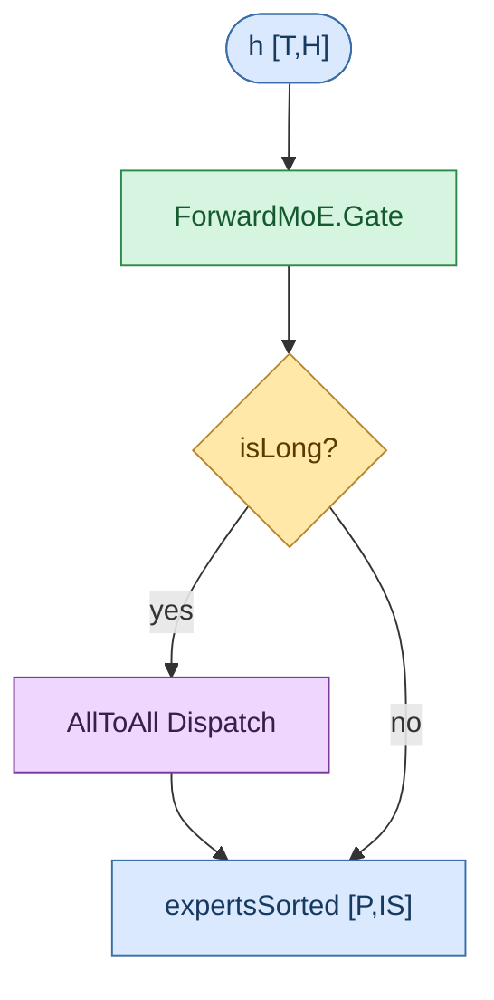

# 流程图规范

本文件是 xlite 的**图示规范**：计算流程图、数据流图、部署拓扑图等的绘制约定（存放于 `doc/conventions/`，该目录仅存放文档规范）。新增流程图请遵循本规范。

## 1. 格式选择

| 优先级 | 格式 | 适用场景 | 渲染方式 |
|--------|------|----------|----------|
| 默认 | **Mermaid** | 绝大多数流程图、时序图、状态机 | GitHub/Gitea 原生渲染 ` ```mermaid ` 代码块 |
| 补充 | **图片（jpg/png）** | Mermaid 难以清晰表达的复杂大图（跨模块拓扑、手绘标注） | 图片存 `images/`，md 里 `` 引用 |
| 禁止 | Graphviz(DOT) / draw.io / Visio 二进制图源 | —— | 不作为图源引入 |

**选择原则**：默认用 Mermaid，图源随 `.md` 纯文本可 diff。只有当 Mermaid 布局难以阅读（跨模块调用、数十个节点嵌套）时，才用手绘图片补充——此时图片是**补充**不是唯一来源。

## 2. 硬性规则

1. **默认文本即图源** —— Mermaid 图源必须是 `.md` 里的纯文本代码块，能被 `git diff` 逐行看到。
2. **图随文档走** —— 图就写在它说明的模块文档里（如 [doc/developer_guide/models/](../developer_guide/models/) 下的架构文档或对应模块 README），不要把图集中堆在独立目录里脱离上下文。
3. **PR 必须可见 diff** —— Mermaid 图改动，PR 里必须能看到对应文本 diff；只换图片不改说明的 PR 需在描述里写明改图原因。
4. **图片为补充、须配文字** —— 用 jpg/png 图片时，md 里必须同时配 mermaid 简化版或结构化文字说明，保留可 diff 的文本线索；图片存 `images/`，源码/接口变更后人工同步重绘并更新图片。

## 3. 文件组织

本目录（`doc/conventions/`）仅存放文档规范：

```text
doc/conventions/
├── README.md                # 目录索引
└── diagram_conventions.md   # 本规范
```

- 流程图本身写在它说明的模块文档里（一张图一个 mermaid 块 + 配套文字说明），见 §2 规则 2；大图额外配 `images/<图名>.png`（存所在模块文档目录的 `images/` 下）。
- 文档用被描述对象的命名，如 `GlmMoeDsaForCausalLM.md`、`moe_dispatch.md`，不要用 `flow1`、`diagram_new`。

## 4. 图示规范

| 形状（Mermaid） | 含义 | 配色（classDef fill / stroke / color） |
|-----------------|------|------------------------------------------|
| `(["..."])` 圆角矩形 | **Tensor**（标注 shape） | `#dbe9ff` / `#3b6ea8` / `#163a5f` |
| `["..."]` 矩形 | **Op 算子**（标注算子名） | `#d6f5e0` / `#2e8a4a` / `#155a2e` |
| `{"..."}` 菱形 | **分支判断** | `#ffe8a8` / `#b8862e` / `#5a3a00` |
| `["..."]` 矩形 + comm class | **集合通信** | `#eed6ff` / `#7a3a9a` / `#3a1e4a` |

- 实线 `-->` 前向数据流；虚线 `-.->` 辅助连线（残差 / 旁路、层循环回边与跨层状态、缓存写入等），具体语义以边标签为准。
- **一条边只走一种箭头语法**：实线标签写 `A -- "label" --> B`，虚线标签写 `A -.->|"label"| B` 或 `A -. "label" .-> B`。禁止在同一条边上混用两种（如 `A -- "是" -.->|"下一层"| B`）——mermaid 解析器在实线标签后期望 `-->`，遇 `-.->` 会报 `Expecting 'LINK', got 'STR'`。需把分支条件与流向说明合并到单个标签里（如 `A -.->|"是: 下一层"| B`）。
- `x`：全程残差基准（输入嵌入，不更新）；`h`：工作张量 `[T,H]`，循环中原地改写。
- 模型架构文档（[doc/developer_guide/models/](../developer_guide/models/)）的图例统一引用本节，不逐文档重复图例表。

### Shape 记号（per-rank / TP 切分后）

| 记号 | 含义 | 记号 | 含义 |
|------|------|------|------|
| `T`/`m` | currTokens（MoE 段写作 `m`，与打包上界 `M` 对照） | `M` | maxTokensDp（DP 对齐上界） |
| `H` | hiddenSize | `nH` | nHeads/tp |
| `qH`/`kH`/`kvH` | q/k/kv heads（`kvH` = nKvHeads/tp，GQA 不足复制） | `hD` | headDim |
| `qLR`/`kvLR` | qLoraRank / kvLoraRank | `rH`/`noH`/`vH` | ropeHeadDim / nopeHeadDim / vHeadDim |
| `nKH`/`nVH` | linearNum(K/V)Heads/tp | `kHD`/`vHD` | linearKey/ValueHeadDim |
| `IS` | moeIntermediateSize/moeTPSize | `E` | nRoutedExperts(+冗余) |
| `nA` | nActExperts | `P` | expertsSorted.shape[0]（≈ M·nA） |
| `blk` | blockSizes[0] | `B` | batch (rt._batch) |
| `aiM`/`aiN` | aicNum/aivNum · XLITE_MAX_M0 | `qkvD` | (nH+2·kvH)·hD（融合 QKV 投影维） |
| `E_loc` | E / moeEpSize（本 rank 物理专家段长度） | | |
| `qD` | Q 头输出总维（GQA：nH·hD；MLA：nH·(noH+rH)） | `qkvcD` | qLR+kvLR+rH（MLA 融合 QKVA 维，不切分） |
| `oD` | nH·vH（MLA 输出头维合计） | `aD` | nH·kvLR（W_UK/W_UV 吸收后 latent 维） |
| `convK` | 线性注意力因果卷积核宽 | `convD` | nKH·kHD·2 + nVH·vHD（conv1d 通道数） |
| `Pg` | 线性状态页数（conv/ssm state 第 0 维，页 0 零页守卫） | `blkN` | paged KV 块数 |
| `tile` | tileSizeOfCachedKV（attention tile 阈值） | `idxNH`/`idxHD` | indexer 头数 / 头维（replicated 不切分） |
| `indexTopK` | indexer 稀疏选块数 | `hcM` | hcMult（MHC 流数） |
| `hcDim` | hcM·H（MHC 残差总维） | `mixHc` | (2+hcM)·hcM（MHC 门控 mixes 维） |
| `laH`/`laHD` | KDA 头数 / 头维（K/V 同维） | `lp` | laH·laHD（KDA per-rank 投影维） |
| `lb` | KDA 衰减门下界 gateLowerBound | `kpool` | kpool 压缩组数 |
| `dInt` | dense MLP 中间维（前 nDense 层） | `sharedIS` | shared expert 中间维（replicated 不切分） |
| `E_phy` | E + numRedundantExperts（EPLB 物理专家总数） | `V` | vocabSize（head 输出维，TP 切分） |
| `oG`/`oLR` | oGroups / oLoraRank（V4 输出低秩分组） | `win` | windowSize（SWA 滑窗宽） |
| `compR` | compress_ratios 逐层值（0/4/128） | `coff` | 压缩器输出系数 = 1 + overlap |
| `nHashLayers` | hash 选路层数（层 0..n-1） | `hcIters`/`hcEps` | MHC Sinkhorn 轮数 / 稳定项 |
| `normEps` | RMSNorm epsilon | | |

### 记号说明与举例要求

图中出现的**每一个 shape 记号**（含复合维度表达式）都必须有明确说明，并以某个真实模型 config 为例给出该记号的具体数值：

1. **每张图自带记号表**：在图前给出本图用到的 shape 记号表，至少含「记号 / 含义 / 取值举例」三列。上方全局表是记号字典，图内记号表可只列该图用到的子集，但不可引入表中未定义的新记号而不说明（新增记号须同时更新本规范全局表）。
2. **举例须用真实模型 config**：取值举例优先取自 [tests/run.sh](../../tests/run.sh) 中的模型测试函数（如 Qwen3.5-0.8B、GLM5.2-w8a8 等），标注模型名与 `tp_size`/`ep_size`；勿用凭空编造的数值。一张图选 1–2 个代表模型即可（如 dense / MoE 各一，或小模型 / 大模型各一），规模跨度大时更能体现架构差异。
3. **复合维度须展开**：图中标注的复合表达式（如 `(nH+2·kvH)·hD + qD`、`lkH·kHD·2 + lvH·vHD`）须在记号表或单独的「复合维度计算示例」表中给出展开式与代入数值的结果（如 `(8+4)·256+2048 = 5120`），便于读者把抽象表达式对应到具体数字。
4. **运行时定的记号标"运行时"**：`T`/`B` 等运行时才确定的值在举例列标「运行时」，不填具体数字，但须说明其含义与上界（如 `T` ≤ `M`）。
5. **测试配置 vs 发布规格**：若举例模型的参数量与发布商标注的规模不一致（测试配置可能为精简规格），须在图说明里注明「按 run.sh 测试配置统计」，避免把测试配置数值误读为模型真实规模。

### subgraph 样式

subgraph（含顶层 `loop` 主循环与各 `Step N` 子图）**统一使用 mermaid 默认底色与字体**，不写 `style <subgraphId> fill:… / color:… / font-weight:… / stroke-dasharray:…` 等着色语句。分组语义由 subgraph 标题文字（如 `Step 3 · …`、`loop · 对每层 …`）与默认边框承担——节点语义已由 classDef 配色（Tensor/Op/Dec/Comm）表达，subgraph 再叠彩色底色只会让单图颜色混杂、图间风格不一。

> 需要强调某子图时，用标题措辞（如标注「关键路径」），不要用底色。

## 5. Mermaid 模板

新增流程图时，复制此模板改写。classDef 配色与上表一致：



> `(["..."])` 圆角矩形表 Tensor，`["..."]` 矩形表 Op/通信，`{"..."}` 菱形表判断。

## 6. 大图（jpg/png）补充约定

当 Mermaid 难以清晰表达时，用手绘图片补充：

- 图片存**所在模块文档目录**的 `images/<图名>.png`（或 `.jpg`）。
- `.md` 里先用 mermaid 或文字给出结构骨架，再 `` 引用大图作为完整呈现。
- 图片是手工产物，源码/接口变更后需人工重绘并更新；PR 描述须写明改图原因（接口变化/新增分支/修正误导）。
- 优先压缩图片体积，建议单图 < 500KB；过大时拆分多张。

## 7. 提交 checklist

- [ ] 图源是纯文本 mermaid 块，`git diff` 可读
- [ ] 配色/形状/箭头符合 §4 约定
- [ ] shape 记号与 §4 表一致（新增记号须同时更新本规范表）
- [ ] 图中所有 shape 记号（含复合维度）均有说明，并以真实模型 config（如 [tests/run.sh](../../tests/run.sh) 中的模型）举例取值；复合维度已展开并算出数值（见 §4「记号说明与举例要求」）
- [ ] 若用图片：已配文字/mermaid 骨架，图片存 `images/` 并在 md 引用
- [ ] 图说明里引用了被描述的源函数名（行号可写可不写，函数名必须有）
- [ ] 每条边只用一种箭头语法，不混用实线/虚线标签（见 §4「箭头」）
- [ ] subgraph 不设自定义 `fill`/`color`/`font-weight`/`stroke-dasharray`，统一 mermaid 默认（见 §4「subgraph 样式」）
- [ ] 改动图的 PR 描述里写明改图原因（接口变化/新增分支/修正误导）
