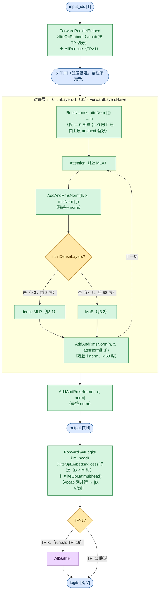
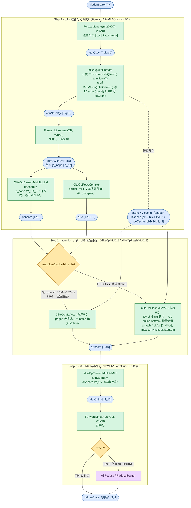
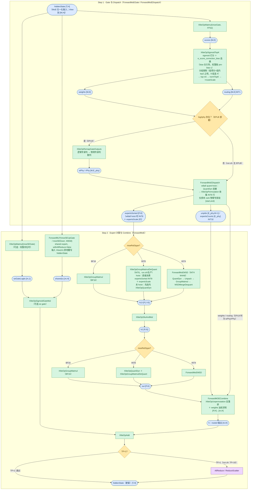

# DeepseekV3ForCausalLM Forward 流程图

DeepSeek-V3 / V3.1 / R1 系列（`model_type=deepseek_v3`，生产入口 `DeepseekV3ForCausalLM`）在 xlite C++ 侧的前向流程。三者 transformer 主干完全同构（61 层，全层 **MLA 注意力**，`attn_type=AttnMLA`）：R1 是 V3 的 RL 后训练版；V3.1 的差异在 MTP 模块（由 vllm 侧投机解码使用，不进入 C++ 主循环）与量化 checkpoint 权重格式（w8a8 使 MLA 投影走静态量化路径）。FFN 为前 `n_dense_layers=3` 层 dense MLP + 后 58 层 MoE（sigmoid 打分 + shared expert）。生产适配器为 `DeepseekV3XliteModel`（`vllm_ascend/xlite/xlite.py`，继承 `Glm4MoeXliteModel`），将 HF config 转为 `ModelConfig` 后进入本图流程。

**与相邻系列的区别**：
- **vs Qwen3（GQA MHA，见 [Qwen3ForCausalLM.md](Qwen3ForCausalLM.md)）**：注意力为 MLA——KV cache 每层每 token 只存 `kvLR+rH` 维 latent（单 latent 头，MQA 形状），`wkv_b`（W_UK/W_UV）在推理时按头吸收进 q/o（逐头 GEMM）；无 QK-norm（改为作用在 lora 段的 `mlaQNorm/mlaKVNorm`）；RoPE 仅 `rH=64` 维 partial（complex 风格）。MoE 为 sigmoid 打分 + `e_score_correction_bias` + 分组限制（`n_expert_groups` 个组选 `n_limited_groups` 个）+ `routeScale` 加权 + **shared expert**（`n_shared_experts=1`，带可选 sigmoid 标量门控）+ **EPLB**（`num_redundant_experts` 与 `log2phy` 重映射）；Qwen3 为 softmax + normTopK、无 bias、无 shared expert、无 EPLB。
- **vs GLM-5 系列**：本系列无 DSA indexer——attention 不做稀疏 top-k token 选择（`ForwardAttnIndexer` 与 `XliteOpGatherSparseKVCache` 仅 `attnType=AttnDSA` 生效，GLM-5 系走此路径）；MoE 侧同为 sigmoid + shared expert，差异集中在 indexer 稀疏分支与 MLA 超参（见 [GlmMoeDsaForCausalLM.md](GlmMoeDsaForCausalLM.md)）。
- 无 hybrid 线性注意力层（每层 full attention）、无 DeepStack / M-RoPE（text-only）、`hcMult==0`（主循环恒走 `ForwardLayersNaive`）。

配置依据（取自 [tests/run.sh](../../../tests/run.sh) 中的真实模型测试函数）：

| 变体 | run.sh 函数 / 模型 | 部署 | FFN | 关键参数 |
|------|--------------------|------|-----|----------|
| `deepseek_v3` | `run_deepseek_v3_w8a8` / **DeepSeek-V3.1-w8a8-mtp-QuaRot** | TP=16 + EP=16（`moe_ep_size=16, moe_tp_size=1`，torchrun 16 卡） | 前 3 层 dense + 后 58 层 MoE | dim=7168, n_heads=128, q_lora_rank=1536, kv_lora_rank=512, qk_nope_head_dim=128, qk_rope_head_dim=64, v_head_dim=128, n_layers=61, n_dense_layers=3, inter_dim=18432, moe_inter_dim=2048, n_routed_experts=256, n_shared_experts=1, n_activated_experts=8, n_expert_groups=8, n_limited_groups=4, route_scale=2.5, score_func=sigmoid, norm_topk_prob=True, 量化 w8a8（激活 BF16）, norm_eps=1e-6（ModelArgs 默认）, RoPE YaRN（theta=1e4, factor=40, original_seq_len=4096）, max_seq_len=1024, max_batch_size=1 |

> 下文数值示例以 **DeepSeek-V3.1-w8a8-mtp**（run.sh 测试配置，TP=16+EP=16 per-rank 视角）为准。`tests/models/deepseek_v3.py` 自带 xlite 后端（`FORWARD_BACKEND=xlite`）。生产 vllm-ascend 适配器 `DeepseekV3XliteModel` 的 config 转换要点：`attn_type=AttnMLA`、`n_kv_heads=1`、`head_dim=0`、`rope_head_dim/nope_head_dim/q_lora_rank/kv_lora_rank/v_head_dim` 取 HF 同名字段、`softmax_scale=(noH+rH)^-0.5`（YaRN 场景乘 `mscale²`）、`n_dense_layers=first_k_dense_replace`、`scoring_func=ScoringFuncSigmoid`、`route_scale=routed_scaling_factor`、`norm_topk_prob`、`n_expert_groups=n_group`、`n_limited_groups=topk_group`、EPLB `num_redundant_experts` + 逐层 `log2phy` 映射表、w8a8 权重按 `deq_scale` 有无自动判别静态/动态量化分支。

源码入口：[`csrc/model.cpp`](../../../csrc/model.cpp) `XModel::Forward` → `ForwardEmbedAndLayers` → `ForwardLayersNaive`；attention 由 `ForwardAttn` 分发（`attnType==XMODEL_ATTN_MLA` → `ForwardAttnMLAV2`）。

## 图例与记号

图例（节点形状与配色、箭头语义）统一见 [图示规范](../../conventions/diagram_conventions.md) §4，本文各节 mermaid 图内的 classDef 与规范一致。

### Shape 记号（per-rank / TP 切分后）

下图所有 shape 记号均为单卡（per-rank）视角，记号均取自 [图示规范](../../conventions/diagram_conventions.md) §4 全局表。`tp_size=16`：MLA 按**头**切分（`nH`、`qD`、`oD`、`aD` 均为切分后行宽；MLA 无 GQA 的 kvH 复制问题，latent 单头各 rank 共享）；dense MLP 权重按 TP 切分；MoE 专家按 EP 切分（`E_loc`）。

| 记号 | 含义 | DeepSeek-V3.1-w8a8（TP=16+EP=16） |
|------|------|-----------------------------------|
| `T` | currTokens（当前步实际 token 数，运行时定，`T` ≤ `M`） | 运行时 |
| `M` | maxTokensDp（每步当前 token 数），上界 = `max_num_batched_tokens` = `max_seq_len·max_batch_size` | ≤1024 |
| `H` | hiddenSize（`dim`） | 7168 |
| `nH` | nHeads / tp（MLA 头切分） | 8 |
| `qLR` | qLoraRank | 1536 |
| `kvLR` | kvLoraRank（latent KV 维） | 512 |
| `noH` / `rH` / `vH` | nopeHeadDim / ropeHeadDim / vHeadDim | 128 / 64 / 128 |
| `qkvcD` | qLR + kvLR + rH（`mlaQKVA` 融合投影输出维，不切分） | 2112 |
| `qD` | nH·(noH + rH)（`mlaQB` 输出维，按头切分后） | 1536 |
| `oD` | nH·vH（`attnOutput` / `attnOut` 输入维） | 1024 |
| `aD` | nH·kvLR（qAbsorb / oAbsorb 行宽，吸收后 latent 维） | 4096 |
| `IS` | inter_dim / tp（dense MLP）；moe_inter_dim / moeTPSize（MoE routed expert；shared expert 见下方注） | 1152 / 2048 |
| `E` | nRoutedExperts | 256 |
| `E_phy` | E + numRedundantExperts（EPLB 物理专家总数） | 256（无 EPLB 冗余） |
| `E_loc` | E_phy / moeEpSize（本 rank 物理专家段 `[start, end)` 长度） | 16 |
| `nA` | nActExperts | 8 |
| `P` | expertsSorted.shape[0] ≈ `M·nA`（dispatch 后 token×专家总数） | M·8 |
| `blk` | blockSizes[0]（测试 64；生产取 vllm cache block） | 64 |
| `blkN` | max_seq_len / blk · max_batch（每层 paged KV 块数） | 16 |
| `B` | batch（rt._batch，运行时定） | 运行时（≤1） |
| `V` | vocabSize（lm_head 输出维，TP 列切分后 V/tp） | 129280（V/tp = 8080） |

### 复合维度计算示例

| 复合维度（图中的表达式） | 展开式 | DeepSeek-V3.1-w8a8（TP=16+EP=16） |
|--------------------------|--------|-----------------------------------|
| `mlaQKVA` 输出 `qkvcD = qLR + kvLR + rH`（§2 `attnQkvc`） | [q_a \| kv_a \| rope] 拼接 | 1536+512+64 = **2112** |
| `mlaQB` 输出 `qD = nH·(noH + rH)`（§2 `attnQWithQr`） | 每头 [q_nope \| q_pe] | 8·192 = **1536**（全局 128·192 = 24576） |
| `qPe` 行宽 `nH·rH`（§2） | 每头 RoPE 后 q | 8·64 = **512** |
| 吸收维 `aD = nH·kvLR`（§2 `qAbsorb` / `oAbsorb`） | q/o 吸收进 latent 空间后的行宽 | 8·512 = **4096** |
| `attnOutput` 维 `oD = nH·vH`（§2） | 输出吸收后 | 8·128 = **1024**（全局 128·128 = 16384） |
| latent KV / token / 层（§2 cache） | kvLR + rH | 512+64 = **576**（BF16 1152 B） |
| dense MLP `h13 [T, 2·IS]` / `h2 [T, IS]`（§3.1） | gate+up 拼接 / 中间激活 | [T, **2304**] / [T, **1152**] |
| MoE gate `weights / routing [M, E]`（§3.2 Step 1） | token×专家打分 | [M, **256**] |
| MoE expert `h13 [P, 2·IS]` / `h2 [P, IS]` / `out [P, H]`（§3.2 Step 2） | gate+up / 中间 / expert 输出 | [M·8, **4096**] / [M·8, **2048**] / [M·8, **7168**] |
| paged KV cache / 层 `[blkN, blk, 1, kvLR]` / `[blkN, blk, 1, rH]`（§2，无 k/v 两份） | latent + rope 双 cache | [16,64,1,**512**] / [16,64,1,**64**] |
| lm_head 输出 `[B, V/tp]`（§1） | vocab 按 TP 列切分，AllGather 后 [B, V] | 129280/16 = **8080** |
| softmaxScale | (noH + rH)^-0.5 | 192^-0.5 ≈ **0.0722** |

> `n_shared_experts=1`：shared expert 中间维 = 1·2048 = 2048，与 routed expert 的 `IS` 相同（`n_shared_experts≠1` 的系列为 `n_shared_experts·IS`）。

---

## 1. 顶层主循环

- `XModel::Forward` → `ForwardEmbedAndLayers` → `ForwardLayersNaive`（`hcMult==0` 恒成立，不画 MHC 分支）。`enableCommOptimize`（token 数 ≥ `commOptimizeLen`，默认 6144，`XLITE_COMM_OPTIMIZE_LEN` 可调）时改走 `ForwardLayersCommOptimize`——层间通信改为 ReduceScatter + AllGather 切片调度，算子序列同构，不另画图。
- `x` 为全程残差基准（不更新）；`h` 为工作张量 `[T,H]`，循环中原地改写；`AddAndRmsNorm` 同时完成残差相加与归一化。
- 层型差异是**同一模型内的 dense/MoE 混合**（前 `n_dense_layers=3` 层 dense、后 58 层 MoE，系列内所有变体一致，非两个变体）：`ForwardFFN` 按层号分发；每层同构 MLA attention（无 hybrid 层分发）。
- w8a8 量化模型的 RMSNorm 带 bias（`attnNormBias/mlpNormBias/normBias` 与 `mlaQNormBias/mlaKVNormBias`，随量化 checkpoint 提供；`norm_eps=1e-6`）。
- lm_head 对应 `ForwardGetLogits`：`ForwardAndGetLogits` = 主干 + lm_head；单独的 `Forward` 任务只输出 hidden states。`B < M` 时先 `XliteOpEmbed(indices)` 按 vllm 侧采样行索引行选 `[M,H] → [B,H]`；TP>1 末尾对 vocab 分片 AllGather。
- 无 DeepStack / M-RoPE：`deepstackNumLevel==0`，层内 `XliteOpAdd` 旁路与 mrope mask 均不生效。MTP 投影层由 vllm 侧投机解码使用，不在 C++ 主循环内。

---

## 2. Attention

全层同型：61 层均为同一 **MLA**（低秩 latent KV cache + q/kv 权重吸收），无层型分发——`ForwardAttn` 按模型级 `attnType` 分发，本系列恒 `AttnMLA` → `ForwardAttnMLAV2`（DSA indexer 分支 `ForwardAttnIndexer` / `XliteOpGatherSparseKVCache` 仅 `AttnDSA` 生效，本系列不进入）。单层链路：`ForwardAttnMLACommonV2`（q/kv 准备）→ Q 吸收（`mlaWUKT`）→ `XliteOpMLAV2` / `XliteOpFlashMLAV2`（attention tile 长短路径）→ `mlaWUV` 输出吸收 → `attnOut` 投影 + TP 通信；`mlaQKVA/mlaQB/attnOut` 为 W8A8 量化权重，`mlaWUKT/mlaWUV`（来自 `wkv_b`）保持 BF16 不量化、推理时按头吸收。

- **融合投影**：`mlaQKVA` 输出 `[q_a | kv_a | rope]` 拼接维 2112（HF 侧 `q_a_proj` + `kv_a_proj_with_mqa`，测试加载时拼接、生产侧 vllm `fused_qkv_a_proj`）；`mlaQB` 列并行按头切，每头输出 `[q_nope(128) | q_pe(64)]`。
- **latent KV cache**：每 token 每层仅缓存 `kvLR=512` 维 latent（kvNorm 归一后）+ `rH=64` 维 RoPE key，共 576 维（BF16 1152 B），无 GQA 的 k/v 双缓存；`kCache/peCache` 由 vllm-ascend 适配器 `extract_kv_cache` 按 `(kv_nope, k_rope)` 对传入。`XliteOpMlaPrepare` 单 AIV 融合 kernel 完成两段 RMSNorm（w8a8 带 `mlaQNormBias/mlaKVNormBias`）+ pe RoPE + 双路 cache 写入（见 [mla_prepare.md](../kernels/mla_prepare.md)）。
- **partial RoPE**：仅 `rH=64` 维、complex 风格——q 侧 `XliteOpRopeComplex` 读每头尾部 64 维输出 `qPe`（见 [rope_complex_and_cache.md](../kernels/rope_complex_and_cache.md)），k 侧融合在 `XliteOpMlaPrepare` 内；`freqsCis` 按适配器 YaRN 参数预计算（测试 `max_seq_len=1024 ≤ original_seq_len=4096`，不启用 YaRN 修正）。
- **权重吸收（absorbed 参数）**：Q 吸收 `qAbsorb = q_nope·W_UK_T` 与输出吸收 `attnOutput = oAbsorb·W_UV`（回 `vH=128` 维）共用 `XliteOpEinsumMhtHtdMhd` 逐头 GEMM（见 [einsum_mht_htd_mhd.md](../kernels/einsum_mht_htd_mhd.md)）；`mlaWUKT/mlaWUV` 取自 `wkv_b` 的 nope / value 段（按头切分，BF16 不量化）；`attnOut` 行并行。
- **量化分支**：`ForwardLinear` 按 QuantType 分流——STATIC（测试 QuaRot checkpoint：`input_scale/quant_bias/deq_scale` → `XliteOpQuant` + `XliteOpMatmulDeQuant`）与 DYNAMIC（生产 vllm-ascend W8A8：`weight_scale` → `XliteOpQuantDyn` + `XliteOpMatmulDeQuant`，适配器按 `deq_scale` 有无自动判别）；`mlaQKVA/mlaQB/attnOut` 均走此分流。语义等价的单 launch 融合算子见 [fused_quant_matmul_dequant.md](../kernels/fused_quant_matmul_dequant.md)。
- **tile 长短路径**：分支条件 `maxNumBlocks·blk ≤ rt._tileSizeOfCachedKV`（`tile`，默认 8192）：短序列走 `XliteOpMLAV2`（见 [mla_v2.md](../kernels/mla_v2.md)）；长序列走 `XliteOpFlashMLAV2`，额外分配 `qk/sv [2·aiM, …]`、`max/sum/lastMax/lastSum` scratch（`aiM` 为全局表记号，见 [flash_mla_v2.md](../kernels/flash_mla_v2.md)）。DSA 的 dense gather 分支（`XliteOpGatherSparseKVCache`）仅 `attnType=AttnDSA` 生效，本系列不进入。
- **latent 空间计算**：内核直接在 `kvLR` 维 latent 空间计算：`QK = (qAbsorb·kCacheᵀ + qPe·peCacheᵀ)·softmaxScale`、`oAbsorb = softmax(QK)·kCache`（MLA 的 V 即 latent kCache）；`softmaxScale = (noH+rH)^-0.5 ≈ 0.0722`，YaRN 场景由适配器乘 `mscale²` 修正后随 config 传入。
- **TP>1 末尾通信**（16 卡恒执行）：`enableCommOptimize` 时 `ReduceScatter`，否则 `AllReduce`。

---

## 3. FFN

`ForwardFFN` 按层号分发：前 `n_dense_layers=3` 层 `ForwardMLP`（§3.1），其后 58 层 `ForwardMoE`（§3.2）。

### 3.1 dense MLP（前 n_dense_layers=3 层）

SwiGLU（`gate·silu(up)`），仅前 3 层；权重 INT8 离线量化（w8a8），激活动态量化。

- `mlpUpGate` 列并行 / `mlpDown` 行并行；`ForwardMLP(withAllReduce=true)` 在 TP>1 时末尾 `AllReduce`（`enableCommOptimize` 时 `ReduceScatter`）。SiLU 融合语义见 [silu_and_mul.md](../kernels/silu_and_mul.md)。
- w8a8 走 DYNAMIC 量化：激活 `XliteOpQuantDyn`（per-token，见 [quant_dyn.md](../kernels/quant_dyn.md)）+ `XliteOpMatmulDeQuant`。以 DeepSeek-V3.1-w8a8（TP=16）为例 `IS=18432/16=1152`：`h13 [T,2304]`、`h2 [T,1152]`。

### 3.2 MoE（后 58 层，gate → dispatch → experts → combine 全链路）

sigmoid 打分 + `e_score_correction_bias` + 分组限制 + `routeScale` + shared expert + EPLB；`y = routed + sigmoid(se_gate(x))·shared(x)`（se gate 可选）；routed expert 按 `moeReDtype` 三分支计算，combine 反重排加权求和，shared expert 叠加。以 **DeepSeek-V3.1-w8a8**（TP=16+EP=16）为例：`E=256`、`E_loc=16`、`nA=8`、`IS=2048`（`moe_tp_size=1`，expert 权重不按 TP 切分）、`routeScale=2.5`、8 组各 32 专家选 4 组。

- **Gate**：`moeGate` 为 FP32 权重。`XliteOpSigmoidTopK` 一次完成（见 [sigmoid_topk.md](../kernels/sigmoid_topk.md)）：`s = sigmoid(scores)`；加 `e_score_correction_bias`（`moeGateBias`，FP32）得 biased 得分 **b 仅引导选路，权重取 pre-bias 的 s**；组得分 = 组内 top2 之和（8 组各 32 专家），选 top `n_limited_groups=4` 组、组外专家 mask 掉；再 top-`nA=8`；权重 normTopK 归一后 ×`routeScale=2.5`。输出 `weights [M,E]` 与 BIT1 掩码 `routing [M,E]`。
- **EPLB 重映射**：部署 EPLB 时（`numRedundantExperts>0` 且逐层 `log2phy` 非空），`XliteOpRemapGateOutputs` 把 gate 输出从逻辑专家列散列到物理专家列（`wPhy/rPhy [M,E_phy]`，`E_phy=E+冗余数`），使 Dispatch 按物理权重槽位索引；非 EPLB（run.sh 测试，`E_phy=E=256`）零开销跳过（见 [remap_gate_outputs.md](../kernels/remap_gate_outputs.md)）。适配器在动态 EPLB 下绑定 per-物理专家权重列表，重均衡经 `.copy_()` 原地更新、C++ 捕获的指针保持有效。
- **Dispatch（非 AllToAll）**：`enableMoEAllToAll=false`（run.sh / 默认；`XLITE_MOE_ALLTOALL` env 控制）走 `XliteOpPermutation`（见 [permutation.md](../kernels/permutation.md)），把 token 按 routing 重排为 expert 分组的 `expertsSorted [P,H]`；EP>1 时仅排本 rank 物理专家段 `[start, end)`（`start = rankId/moeTPSize · E_loc`，每 rank 16 个物理专家）。`unpIdx [E_phy, M+1]` 记录逆重排索引（`[e,t]` 为 token t 在专家 e 段内的行号，末列为各专家段起始偏移，`[0,0]` 复用存放本 rank 总行数）、`expertsCounts [E_phy]` 为逐专家行数；`num`（即 `unpIdx[0]`）传给下游量化 / GroupMatmul 跳过 padding 行；`mAllDp ≥ 1024` 时预分配行数按 `activeTokensRatioPerEp`（默认 1.0 即不压缩）调整。
- **w8a8 quant-hoist**（`moeReDtype==INT8` 且 `hiddenSize%32==0`，非 AllToAll / graph 通信，默认启用，run.sh w8a8 即走此路）：`XliteOpQuantDyn` 前置到 permutation 之前（per-token 量化 hiddenState），permutation 收集 INT8 行并把 per-token scale 搭带散射到对应专家槽，`expertsSorted` 为 INT8、另有 `expertsScale [P]` FP32（`expertsSorted` 缓冲减半、量化 M 行而非 P 行、DP>1 AllGather 载荷减半）；`XLITE_DISABLE_MOE_QUANT_HOIST` 可回退 legacy BF16 收集。
- **DP>1**（本配置 DP=1）：dispatch 前另有 AllGather 打包分发（`XliteOpConcat` → `AllGather` → `XliteOpSplit`），图中省略。AllToAll 变体 `ForwardMoEDispatchAllToAll`（EP 间 `XliteOpAlltoAllV` + `XliteOpReorderMoE` 源分组重排）与 `ForwardMoEDispatch` 在 `ForwardMoE` 内二选一；**EPLB + AllToAll 组合当前抛错不支持**。
- **Expert 三分支**（`moeReDtype`，up/gate 与 down 两段各自独立走该分支，down 段 `h2` 恒段内 `QuantDyn`）：BF16 → `XliteOpGroupMatmul`（按 expert 分组的 batched matmul，见 [group_matmul.md](../kernels/group_matmul.md)）；INT8（w8a8，run.sh 与生产同路径，权重 INT8 离线量化）→ quant-hoist 生效时直接 `XliteOpGroupMatmulDeQuant`（`expertsScale` 参与解量化），未 hoist（AllToAll / graph 通信 / 显式禁用）才段内 `XliteOpQuantDyn`（per-token 动态量化，见 [quant_dyn.md](../kernels/quant_dyn.md)）；INT4（W4A8）→ `ForwardMoEMSD`（QuantDyn → Unpack → INT4 GroupMatmul → MSDMergeDequant 四段流水，见 [msd_merge_dequant.md](../kernels/msd_merge_dequant.md)）。`h13 [P,4096]`（gate/up 拼接）、`h2 [P,2048]`、`out [P,7168]`。
- **Combine**：`ForwardMOECombine` 用 `XliteOpUnpermutation` 反重排 + 按 `weights` 加权求和把 `[P,H]` 还原回 `[M,H]`（见 [unpermutation.md](../kernels/unpermutation.md)）；DP>1 时再经 `ReduceScatter` 归并各 DP 份。
- **shared expert**（`n_shared_experts=1` 恒走）：combine 先把 routed 输出写入独立张量 `h`（不覆写输入）；se gate logits 必须在覆写前先算（`ForwardMLP` 会覆盖输入）；随后 `ForwardMLP(moeSEUpGate/moeSEDown, W8A8, withAllReduce=false)` 以 MoE 归一化输入（图 `h` 的 `View(m)`）原地覆写 hiddenState 计算 `shared(x)`，最后 `XliteOpAdd` 合并。不满足计算条件的 rank（见「shared expert 权重部署差异」）走 else 分支：combine 直接写回 hiddenState。
- **se gate 可选**：`moeSEGate` 权重存在时走 `XliteOpSigmoidGateMul`（`shared(x)·sigmoid(se_gate(x))`，见 [sigmoid_gate_mul.md](../kernels/sigmoid_gate_mul.md)）；DeepSeek-V3 系 HF config 无 `shared_expert_gate`（适配器亦未绑定）→ 跳过该步，直接 `routed + shared(x)`。该 sigmoid 门控路径为 `ForwardMoE` 内共用可选结构（当前绑定它的接入路径仅 Qwen3.5 系列，见 [Qwen3_5ForConditionalGeneration.md](Qwen3_5ForConditionalGeneration.md)；GLM-5 系列 [GlmMoeDsaForCausalLM.md](GlmMoeDsaForCausalLM.md) 同样未绑定）。
- **shared expert 权重部署差异**：测试配置 shared 权重完整加载（不切分）→ 仅 rank 0 计算，结果由末尾 TP AllReduce 求和；生产 vllm-ascend TP 切分（列并行 up / 行并行 down）→ 所有 rank 各算列分片，同样经 AllReduce 合并。两种部署数学等价。
- **TP>1 末尾通信**：非 AllToAll 恒执行 `AllReduce`（`enableCommOptimize` 时 `ReduceScatter`）；AllToAll 模式（`ForwardMoECombineAllToAll`）下跳过。
