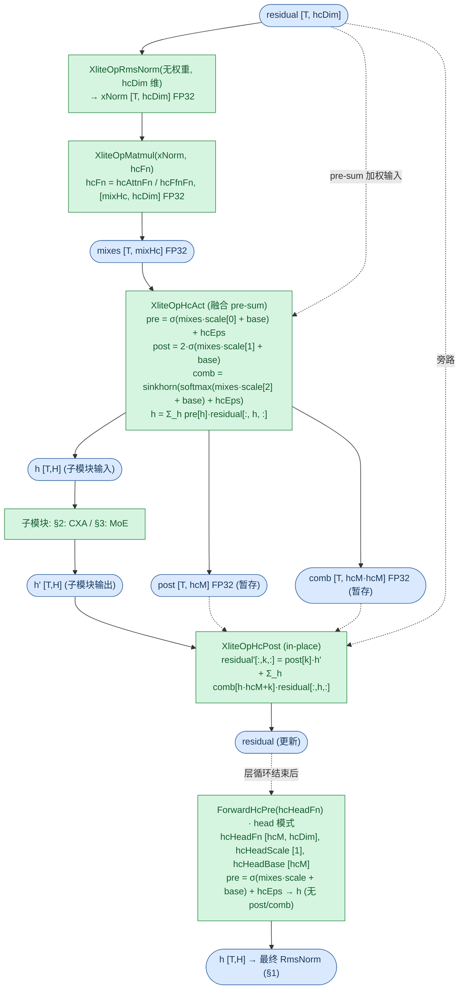
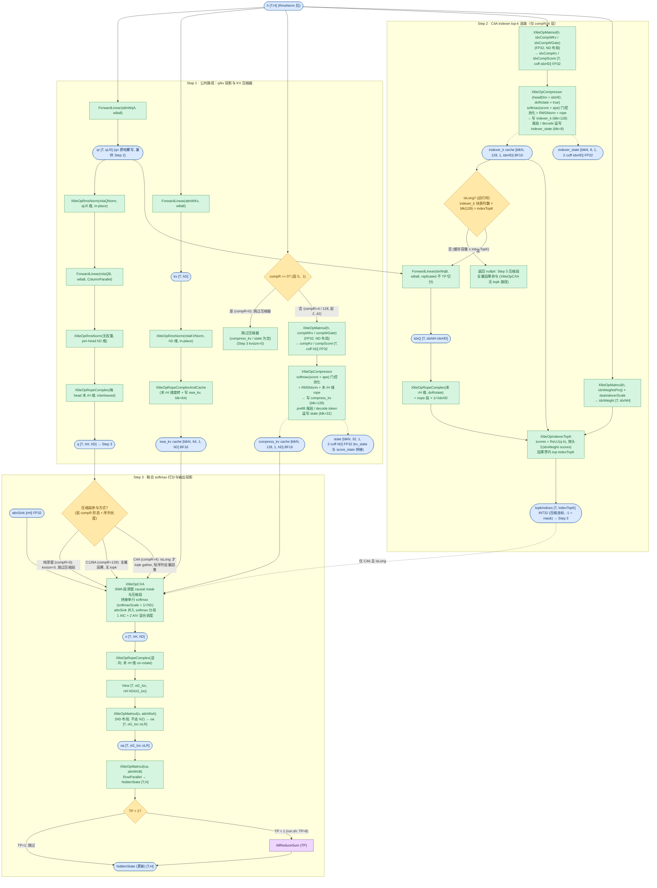
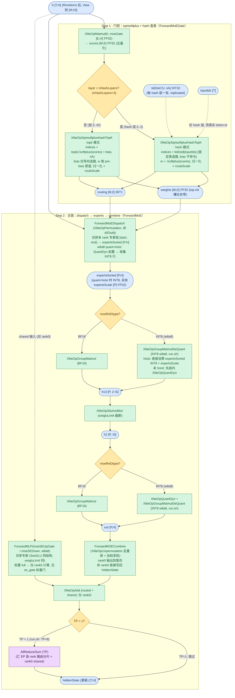

# DeepseekV4ForCausalLM Forward 流程图

DeepSeek-V4（Flash）系列（`model_type=deepseek_v4`，xlite `attnType=XMODEL_ATTN_CXA`）在 xlite C++ 侧的前向流程。架构三要素：**MHC 多流超连接**（`hc_mult=4`，43 层全程走 `ForwardLayersMhc` 多流残差）、**CXA 压缩稀疏注意力**（每层按 `compress_ratios` 取 0/4/128 三种形态：纯滑窗 / C4A（压缩比 4 + Indexer top-k）/ C128A（压缩比 128，无 Indexer））、**全层 MoE**（`n_dense_layers=0`，sqrtsoftplus 门控，前 `n_hash_layers=3` 层按 token-id 查表选路，另含 1 个共享专家）。CxA 与 MHC 绑定：`Init` 强制 `hc_mult != 0`，`ForwardAttn` 也不分发 CXA——本系列只能经 `ForwardLayersMhc` 主循环进入。

生产适配器（vllm-ascend 的 `xlite.py`）当前无 V4 专有类，本文按测试路径 [tests/models/deepseek_v4.py](../../../tests/models/deepseek_v4.py) 的 `forward_xlite` 接入描述（`forward_v2` + per-layer `freqs_cis` 列表 + `forward_get_logits`）。

**与 DeepSeek-V3 系列的区别**（图见 [DeepseekV3ForCausalLM.md](DeepseekV3ForCausalLM.md)）：V3 无 MHC（标准残差 `ForwardLayersNaive`/`ForwardLayersCommOptimize`），注意力为标准 MLA（`attnType=AttnMLA`，token 级 KV，无 indexer 稀疏选路），MoE 为 sigmoid 门控；V4 残差改为 hcM 条流的门控混合（`hc_attn_fn`/`hc_ffn_fn`/`hc_head_fn` 参数化），注意力改为滑窗段 + 压缩段拼接联合 softmax 的 CXA（K/V 同源单缓存，带 attn_sink），indexer 仅存在于 compR=4 层且在压缩坐标上选路，MoE 改为 sqrtsoftplus（+hash 层）门控 + `swiglu_limit` 截断。

**与 GLM-5.3-Flash 的区别**：同为 MHC 多流包装（hcMult=4），但 GLM-5.3 按 `layer_types` 混合 KDA 线性注意力与稀疏 MLA，层尾用**无参数** mean collapse 合并流（参考实现，C++ 尚未实现）；V4 每层同构走 CXA（仅 compress_ratios 分流），层尾用**参数化** `hc_post`（post/comb 门 + Sinkhorn），最终 `hc_head` 亦为参数化 pre 门；MoE 门控 V4 为 sqrtsoftplus + hash 选路，GLM-5.3 为 sigmoid topk；部署同为 TP 切 head + EP 切 expert（EP 与 TP 同组 8 卡）。

配置依据（取自 [tests/run.sh](../../../tests/run.sh) 的 `run_deepseek_v4_w8a8` / **DeepSeek-V4-Flash-w8a8-mtp**；checkpoint 名带 mtp 后缀，测试配置 `n_mtp_layers=0`）：

| 变体 | run.sh 函数 / 模型 | 部署 | FFN | 关键参数 |
|------|-------------------|------|-----|----------|
| `deepseek_v4`（Flash） | `run_deepseek_v4_w8a8` / **DeepSeek-V4-Flash-w8a8-mtp** | TP=8 + EP=8（同组 8 卡，`moe_ep_size=8, moe_tp_size=1`，dp=1） | 全 MoE + 1 shared expert | dim=4096, n_layers=43, n_heads=64, head_dim=512, rope_head_dim=64, q_lora_rank=1024, o_groups=8, o_lora_rank=1024, window_size=128, compress_ratios（层 0/1=0，层 2..42 交替 4/128，另 1 个尾部幻影项，共 44 项）, index_n_heads=64, index_head_dim=128, index_topk=512, hc_mult=4, hc_sinkhorn_iters=20, hc_eps=1e-6, n_hash_layers=3, n_routed_experts=256, n_activated_experts=6, score_func=sqrtsoftplus, route_scale=1.5, swiglu_limit=10.0, norm_topk_prob=True, w8a8 动态量化，n_mtp_layers=0, max_batch_size=1, max_seq_len=1024, vocab=129280 |

> 下文 shape 数值示例均为 **per-rank 视角**（TP=8 + EP=8，取 run.sh 配置）。w8a8 为**动态**量化：激活侧 `XliteOpQuantDyn` 逐 token 量化，权重 INT8 带 per-row scale/offset（参考实现见 [tests/models/deepseek_v4.py](../../../tests/models/deepseek_v4.py) 的 `Linear`）。

## 图例与记号

图例（节点形状与配色、箭头语义）统一见 [图示规范](../../conventions/diagram_conventions.md) §4，本文各节 mermaid 图内的 classDef 与规范一致。

### Shape 记号（per-rank / TP 切分后）

| 记号 | 含义 | 取值（DeepSeek-V4-Flash-w8a8，TP=8+EP=8） |
|------|------|------|
| `T` | currTokens | 运行时（≤ 1024） |
| `M` | maxTokensDp | 运行时（dp=1 时 = T，上界 1024） |
| `B` | batch（≤ max_batch_size） | ≤ 1 |
| `H` | hiddenSize | 4096 |
| `hcM` | hcMult（MHC 流数） | 4 |
| `hcDim` | hcM·H（MHC 残差总维） | 16384 |
| `mixHc` | hc 门控输出维 (2+hcM)·hcM | 24 |
| `hcIters` / `hcEps` | hcSinkhornIters / hcEps（Sinkhorn 轮数 / 稳定项） | 20 / 1e-6 |
| `nH` | nHeads/tp | 64/8 = 8 |
| `hD` | headDim = kv_lora_rank = v_head_dim（V4 无独立 kv/v 维） | 512 |
| `rH` / `noH` | ropeHeadDim / nopeHeadDim（hD - rH） | 64 / 448 |
| `qLR` | qLoraRank | 1024 |
| `oG` / `oG_loc` | oGroups / oGroups÷tp（本 rank 组数） | 8 / 1 |
| `oLR` | oLoraRank | 1024 |
| `win` | windowSize（SWA 滑窗宽） | 128 |
| `compR` | compress_ratios 的逐层值 | {0, 4, 128} |
| `coff` | 压缩器输出系数 = 1 + overlap（overlap：compR==4 时为 1，否则 0） | C4A 为 2，其余为 1 |
| `idxNH` | indexNHeads（replicated，不 TP 切分） | 64 |
| `idxHD` | indexHeadDim | 128 |
| `indexTopK` | 压缩段 top-k 路数 | 512 |
| `IS` | moeIntermediateSize（EP 内每专家） | 2048 |
| `E` / `E_loc` | nRoutedExperts / E÷moeEpSize | 256 / 32 |
| `nA` | nActExperts | 6 |
| `nHashLayers` | hash 选路层数（层 0..nHashLayers-1） | 3 |
| `P` | expertsSorted 行数（本 rank 分片，总 ≈ M·nA） | ≈ 6144 |
| `blk` | 缓存平面块大小（五平面 per-plane，见 §2 kvCache 表） | {8, 128, 128, 32, 64} |
| `V` | 词表大小 | 129280 |

### 复合维度计算示例

| 表达式 | 展开 | 代入（DeepSeek-V4-Flash-w8a8） |
|--------|------|------|
| MHC 残差维 `hcDim = hcM·H` | 4·4096 | **16384** |
| hc 门控维 `mixHc` / head 模式 `hcM` | (2+4)·4 / 4 | **24** / **4** |
| q 投影维 `qD = nH·hD` | 8·512 | **4096** |
| 压缩器输入 `coff·hD` | C4A 为 2·512，C128A 为 1·512 | **1024** / **512** |
| compress state 维 `2·coff·hD` | C4A 为 2·1024，C128A 为 2·512 | **2048** / **1024** |
| indexer 压缩输入 `coff·idxHD` / state 维 `2·coff·idxHD`（仅 C4A） | 2·128 | **256** / **512** |
| indexer q 维 `idxNH·idxHD`（replicated） | 64·128 | **8192** |
| o 分组输入 `nH·hD/oG_loc` / `oa = oG_loc·oLR` | 4096/1 / 1·1024 | **4096** / **1024** |
| wo_a / wo_b per-rank 权重 | [oG·oLR/tp, nH·hD/oG_loc] / [H, oG·oLR/tp] | **[1024, 4096]** / **[4096, 1024]** |
| SWA 窗块数 `win/blk_swa` | 128/64 | **2** 块 |
| 压缩 token 数 `max_seq_len/compR` | C4A 为 1024/4，C128A 为 1024/128 | **256** / **8** |
| MoE expert `2·IS` / `IS` | 2·2048 / 2048 | **4096** / **2048** |

---

## 1. 顶层主循环

源码入口：[csrc/model.cpp](../../../csrc/model.cpp) 的 `Forward` → `ForwardEmbedAndLayers`（`hcMult != 0` 恒走 MHC 分支；`hcMult == 0` 的 Naive / CommOptimize 路径本系列不适用，不画）→ `ForwardLayersMhc`。

```mermaid
flowchart TB
  classDef tensor fill:#dbe9ff,stroke:#3b6ea8,color:#163a5f
  classDef op     fill:#d6f5e0,stroke:#2e8a4a,color:#155a2e
  classDef dec    fill:#ffe8a8,stroke:#b8862e,color:#5a3a00
  classDef comm   fill:#eed6ff,stroke:#7a3a9a,color:#3a1e4a

  in(["input_ids [T]"]):::tensor
  embed["ForwardParallelEmbed<br/>(每 rank 持 vocab/tp 段)<br/>(命中段查表 / 未命中段填 0)"]:::op
  are["AllReduceSum (TP)"]:::comm
  x(["x [T,H]"]):::tensor
  concat["XliteOpConcatCol(x × hcM)"]:::op
  residual(["residual [T, hcDim]<br/>(hcM 条流, 跨层原地改写)"]):::tensor

  subgraph loop ["loop · 对每层 i = 0 .. nLayers-1 (43, 全为 MoE 层)"]
    direction TB
    hcpreA["ForwardHcPre(hcAttnFn[i])<br/>参数化门控混合 + pre-sum → h<br/>(pre/post/comb + Sinkhorn, 见 §1.1)"]:::op
    normA["XliteOpRmsNorm(h, attnNorm[i])"]:::op
    attn["§2: CXA (ForwardAttnCXA)<br/>全层同型, 按层 compR = 0 / 4 / 128 分流"]:::op
    hcpostA["ForwardHcPost<br/>按 post/comb 门原地写回 residual (见 §1.1)"]:::op
    hcpreF["ForwardHcPre(hcFfnFn[i]) → h"]:::op
    normF["XliteOpRmsNorm(h, mlpNorm[i])"]:::op
    ffn["§3: MoE (ForwardMoEGate → ForwardMoE)<br/>全层同型, sqrtsoftplus·hash 门控 + shared expert"]:::op
    hcpostF["ForwardHcPost → residual"]:::op
    hcpreA --> normA --> attn --> hcpostA --> hcpreF --> normF --> ffn --> hcpostF
    hcpostF -.->|"i &lt; nLayers-1: 下一层, residual 原地续写"| hcpreA
  end

  hchead["ForwardHcPre(hcHeadFn) · head 模式<br/>仅 pre-sum → h (见 §1.1)<br/>(无 post/comb/Sinkhorn)"]:::op
  finalnorm["XliteOpRmsNorm(h, norm)"]:::op
  lmhead["ForwardGetLogits<br/>(batch &lt; T 时先按 indices 采样行<br/>h × head, head 按 vocab/tp 切分, FP32)"]:::op
  arh["AllGather (TP)"]:::comm
  logits(["logits [B, V] FP32"]):::tensor

  in --> embed --> are --> x --> concat --> residual --> loop
  loop --> hchead --> finalnorm --> lmhead --> arh --> logits
```

关键点：

- `ConfigRtCommOptimize` 要求 `hcMult == 0` 才启用通信优化（[csrc/model.h](../../../csrc/model.h)），故 MHC 路径所有 TP 尾通信恒为 `DispatchAllReduceSum`（无 ReduceScatter）。
- MHC 无首层特殊分支（`ForwardLayersNaive` 的 i==0 从 x 归一化起步在此不适用）：每层统一由 `ForwardHcPre` 从 residual 生成 h；`post`/`comb` 暂存张量在循环外分配一次，每次 `ForwardHcPre` 覆写、由随后最近的 `ForwardHcPost` 消费。
- 层循环结束后 `hc_head` 输出送最终 `RmsNorm`，再 `ForwardGetLogits`（`batch < T` 时先 `XliteOpEmbed` 按 indices 采样目标行，再 head 按 vocab/tp 切分的 FP32 matmul，末尾 AllGather 汇 TP 各段）。
- MTP：`n_mtp_layers=0`（run.sh），C++ 侧无 MTP 前向字段，checkpoint 的 `mtp.*` 权重由测试加载器跳过；MTP 推测解码由 vllm-ascend 侧处理。

### 1.1 MHC 门控混合单元（ForwardHcPre / ForwardHcPost / hc_head）

`ForwardHcPre` 与 `ForwardHcPost` 在每层 attention / FFN 前后成对出现；`hc_head` 是循环结束后的 head 模式（仅 pre 门，无 post / comb / Sinkhorn）。

关键点：

- `comb` 经 `hcIters`（20）轮 Sinkhorn 行列归一，ε = `hcEps`（1e-6）；公式与实现见 [hc_act](../kernels/hc_act.md) 与 [hc_post](../kernels/hc_post.md)，数学参考 [tests/models/deepseek_v4_kernel.py](../../../tests/models/deepseek_v4_kernel.py) 的 `hc_split_sinkhorn`。
- hc 门控前的 RmsNorm 为**无权重**形式（`XliteOpRmsNorm` 权重传空张量，eps 取 `norm_eps`），输出 FP32 供 matmul；`hcFn`/`hcScale`/`hcBase` 为 FP32，不经量化。
- head 模式由 `hcFn` 输出维 == hcMult 识别（`XliteOpHcAct` 的 headOnly 分支）：head 的 `hcHeadFn` 为 [hcM, hcDim] 而非 [mixHc, hcDim]。
- `XliteOpHcPost` 原地改写 residual；`hc_head` 之后无 hc_post，多流语义到此终止。

---

## 2. Attention

43 层 attention **全层同型**：CXA 压缩稀疏注意力（q/kv 公共路径 → C4A indexer top-k 选路 → 联合 softmax → 输出投影），入口 [csrc/model.cpp](../../../csrc/model.cpp) 的 `ForwardAttnCXA` 固定调用序 `ForwardAttnCXACommon` → `ForwardAttnCXAIndexer`（仅 compR=4 层）→ 尾段打分与输出投影；层内不换层型，仅按 `compress_ratios` 取值分流。机制要点：

- **K/V 同源单缓存**：V4 的 `kv_lora_rank = v_head_dim = head_dim = hD`，`wkv` 直接 H→hD、无独立 v 投影；同一 kv 缓存同时充当 K 与 V（scores = q·kv、输出 = softmax·kv，见 [cxa](../kernels/cxa.md)）。
- **滑窗段 + 压缩段拼接联合 softmax**：SWA 段（可见窗 [max(0, q-win+1), q]）与压缩段（因果可达的压缩 token）拼接在同一行分数上，乘 softmaxScale = 1/√hD 后做单个 softmax；`attn_sink`（per-head FP32，随 head 切分）并入分母，不做显式 logit bias——与标准 DSA/MLA 打分的本质差异。

`compress_ratios` 共 **44 项 = 43 个 per-layer 值 + 1 个尾部幻影项**（末项 0，对应 MTP-draft 槽位；`Init` 仅校验 `size ≥ n_layers` 并容忍尾项，[tests/models/xlite_utils.py](../../../tests/models/xlite_utils.py) 注释称「44 entries incl. the trailing MTP phantom 0」）。逐层三形态与每层状态缓存（`kvCache[layer]` 为 5 元组，`CxaCacheIndex` 枚举定义于 [csrc/runtime.h](../../../csrc/runtime.h)；示例 shape 取 max_seq_len=1024、max_batch=1，blkN = ceil（容量，blk）；compress_kv 为各 ratio 共享的通用池，同一 blkN 按 compR 界限行走；分页 block table 与 slot 映射由 host 侧 AttnMetaV2 的 per-layer plane 提供，见 `prepare_xlite_attnmeta_v2`）：

| 形态 | 层号（compR） | Indexer | 压缩段参与（Step 3） | 非空缓存槽与示例 shape |
|------|------|------|------|------|
| 纯滑窗 | 0、1（compR=0） | 无 | kvsize=0，kernel 退化纯滑窗 | swa_kv [16, 64, 1, 512] BF16 |
| C4A | 2, 4, …, 42（21 层，compR=4） | 有（top-k） | isLong 时按 topkIndices gather；短序列全量因果 | 全 5 槽：indexer_state [128, 8, 1, 512] FP32；indexer_k [2, 128, 1, 128] BF16；compress_kv [8, 128, 1, 512] BF16；state [32, 32, 1, 2048] FP32；swa_kv [16, 64, 1, 512] BF16 |
| C128A | 3, 5, …, 41（20 层，compR=128） | 无 | 全量因果（无 topk） | compress_kv / state / swa_kv：state [32, 32, 1, 1024] FP32，其余同上（indexer 两槽为空） |

`state` / `indexer_state` 为 FP32，内容为 kv_state 与 score_state 拼接（压缩器流式溢写）；kvCache 元组长度按层 compR 变化（C8 层再加 1 个 `indexer_k_scale` 槽，本配置 `index_c8_mask` 为空，无 C8 层）。

同一层型的完整 forward 一张图按调用序分 Step 展示（Step 1 `ForwardAttnCXACommon` / Step 2 `ForwardAttnCXAIndexer` / Step 3 `ForwardAttnCXA` 尾段，Step 间以实线前向边衔接）：

关键点：

- 双路 LoRA：`q = WqB(RmsNorm(WqA(h)))`，`mlaQB` 为 ColumnParallel（按 head 切，per-rank [qD, qLR] = [4096, 1024]）；q 的 per-head RmsNorm 无权重。
- RoPE 按层不同（`freqs_cis` 为 per-layer 列表）：压缩层（compR≠0）用 `compress_rope_theta=160000` + YaRN（`original_seq_len=65536, rope_factor=16, beta 32/1`）；非压缩层（层 0/1）用 `rope_theta=10000`、`original_seq_len=0`。
- 压缩器权重 `compWKv`/`compWGate`（与 Step 2 的 indexer 压缩权重）为 FP32 **ND 布局**，不经 NZ 转换；`XliteOpCompressor` 细节见 [compressor](../kernels/compressor.md)：门控加权池化 `weightedSum = Σ_k softmax(score[k] + ape[k])·kv[k]`，每个压缩块的窗口 `mergeSize = coff·compR` 行、相邻块步长 `compR`（压缩 token 数 ≈ len/compR），随后 RMSNorm + 末 rH 维 RoPE 写入 compress_kv；compR=128 时 kernel 走分块列切片路径。
- `state` 溢写：prefill 尾段（未被完整压缩窗口覆盖的行）与 decode 单 token 写入 state（kv_state + score_state 拼接 FP32），供下一步 / 下一 chunk 的压缩窗口读取。
- indexer 压缩器与 Step 1 主压缩器同算子不同参数：headDim 用 idxHD=128（主压缩器为 hD=512），`doRotate = true` 把均匀 rotate scale 折叠进 rope 输出（参考实现的 `rotate_activation`），故 idxK 无独立 scale 张量。
- `idxWqB` **replicated**（每 rank 全量 [idxNH·idxHD, qLR] = [8192, 1024]，不 TP 切分）；`idxQ` 复用 Step 1 的 `qr`（qNorm 后）再投影；`idxWeight = weights_proj(h)`，乘 `_dsaIndexerScale = 1/√(idxNH·idxHD)`（= 参考实现的 `softmax_scale·n_heads^-0.5`，softmax_scale = idxHD^-0.5）。
- `isLong` 为运行时判据：该层 indexer_k 块表列数（缓存容量）× blk（128）是否 > indexTopK（512）；短序列直接全量因果，跳过 top-k（indexer_k 仍已写入缓存）；`XliteOpIndexerTopK` 细节见 [indexer_topk](../kernels/indexer_topk.md)（因果界 p0 = (pos+1)/compR - 1，输出压缩坐标，-1 表示 mask）。
- kernel 侧另有 LI-C8（indexer K 量化 INT8 + FP16 scale）路径（`indexer_prepare_c8`/`quant_q_c8`/`quant_cache_c8`），本配置 `index_c8_mask` 为空，不启用。
- 三种压缩段参与方式见本节开头三形态表（compR 形态 + 运行时 `isLong` 共同决定）。
- kernel 为 AIC（QK/SV 主算）+ AIV（softmax）混合调度；scores workspace 的 SWA 段宽度 `swaSegWidth = win + XLITE_MAX_M0 + K_BLOCK_SIZE_2B = 128+128+16 = 272`，压缩段宽度 `kvsize = ROUND_UP(maxTotalLens/compR, 4·CXA_SVCK0 = 256)`。
- 输出投影为分组低秩两段：`wo_a` ColumnParallel（出维按 o 组切，per-rank [1024, 4096]，ND 布局不走 NZ），`wo_b` RowParallel（per-rank [4096, 1024]，尾端即图中 AllReduce）。run.sh 的 TP=8 = oG，每 rank 恰持 1 个完整组（oG_loc = oG/tp = 1）。
- o 的末 rH 维处于旋转域（kv 先 rope 再缓存且 K/V 同源），故先 `XliteOpRopeComplex` 逆向 un-rotate 再投影（[rope_complex_and_cache](../kernels/rope_complex_and_cache.md)）。
- `XliteOpCXA` 仅 BF16 输入；模型路径恒分页模式（`XliteOpFlashCXA` 仅 standalone 入口，不在模型前向出现）。

---

## 3. FFN

43 层 FFN **全层同型**：MoE（sqrtsoftplus·hash 门控 + 1 个共享专家，`n_shared_experts=1`，同结构 SwiGLU，`swiglu_limit` 同）。`n_dense_layers=0`（checkpoint config 无 dense 前层字段，测试加载器显式置 0），`ForwardFFN` 对全部层直接分派 `ForwardMoE`，入口链 `ForwardMoEGate`（门控）→ `ForwardMoE`（dispatch → experts → combine），见 [csrc/model.cpp](../../../csrc/model.cpp)。

同一层型的完整 forward 一张图按调用序分 Step 展示（Step 1 `ForwardMoEGate` 门控 / Step 2 `ForwardMoE` 主链，Step 间以实线前向边衔接）：

关键点：

- 门控权重 `moeGate` 为 FP32（checkpoint bf16 转 fp32，打分稳定），打分为普通 `XliteOpMatmul`（h × moeGate → scores [M,E] FP32，无量化）；`sqrtsoftplus` 语义：`s0 = √softplus(scores)`（[sqrtsoftplus_hash_topk](../kernels/sqrtsoftplus_hash_topk.md)）。
- hash 层（层 0..nHashLayers-1）indices 直接取 `tid2eid[input_ids]`（[V, nA] int32 表，bias 不参与）；非 hash 层 indices = topk(s0 + bias)——**bias 仅导向 topk 选路，权重取 pre-bias 原值**；两种模式的权重都归一化后再 ×`routeScale`（1.5）。
- hash 层要求真实 input_ids：`ForwardMoEGate` 在 hash 层且未传 inputIds 时抛错（`forward_with_inputs_embeds` 可选携带 inputIds 即为此设）。
- EPLB `log2phy` 重映射存在但本配置无冗余专家，零开销跳过。
- Dispatch 走 `XliteOpPermutation` 非 AllToAll（run.sh 未开 moe AllToAll）：EP=8 下每 rank 只排 `[rank·E_loc, (rank+1)·E_loc)` 段（P 为本 rank 分片行数，总路由行数 ≈ M·nA）。
- **w8a8 quant-hoist**（`moeReDtype==INT8` 且 `hiddenSize%32==0`，非 AllToAll / graph 通信，默认启用，run.sh 即走此路）：`XliteOpQuantDyn` 前置到 permutation 之前（per-token 量化 hiddenState），permutation 收集 INT8 行并把 per-token scale 搭带散射到对应专家槽，`expertsSorted` 为 INT8、另有 `expertsScale [P]` FP32（`expertsSorted` 缓冲减半、量化 M 行而非 P 行、DP>1 AllGather 载荷减半）；`XLITE_DISABLE_MOE_QUANT_HOIST` 可回退 legacy BF16 收集。
- w8a8（INT8）路径：up/gate 段 quant-hoist 生效时直接 `XliteOpGroupMatmulDeQuant`（`expertsScale` 参与解量化），未 hoist（AllToAll / graph 通信 / 显式禁用）才段内 `XliteOpQuantDyn`；down 段 `h2` 恒段内 `XliteOpQuantDyn` + `XliteOpGroupMatmulDeQuant`；BF16 路径为 `XliteOpGroupMatmul`；INT4 MSD 走 `ForwardMoEMSD`（本配置不走）。
- `swiglu_limit=10`：`up = clamp(up, -10, 10)`、`gate = clamp(gate, max=10)`（[silu_and_mul](../kernels/silu_and_mul.md)），共享专家同样启用。
- 共享专家权重 full 加载但仅 rank0（rankId % tpSize == 0）计算；combine 输出与 shared 在 rank0 相加后，由本层 MoE 尾部的同一 `AllReduceSum` 汇入（EP 与 TP 同组 8 卡，等效参考实现的 all_reduce 后加 shared）；非 rank0 直接写回 combine 结果。
