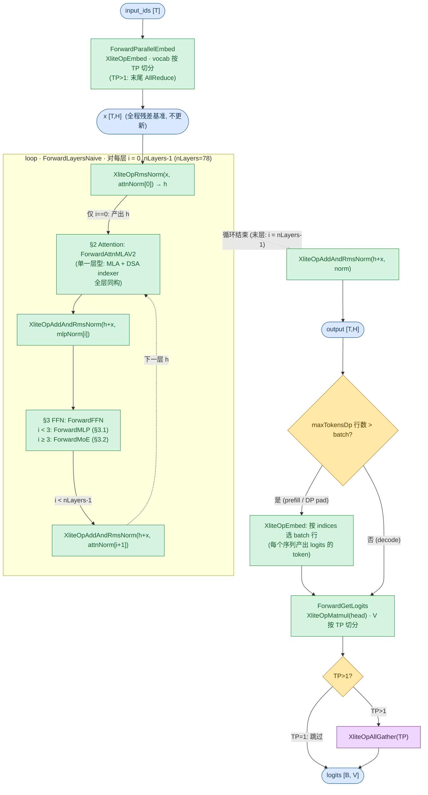
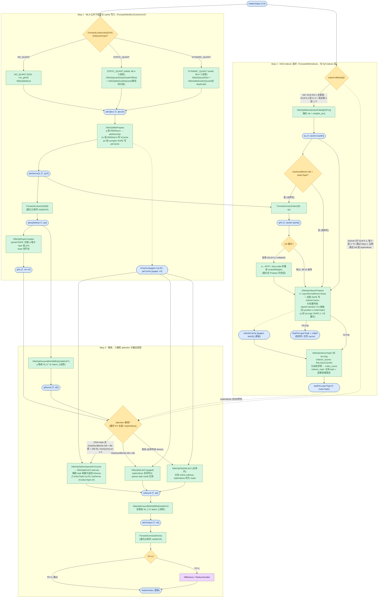
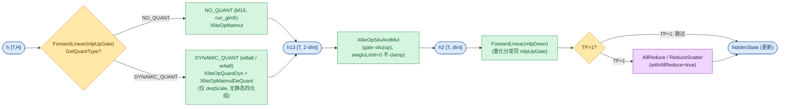
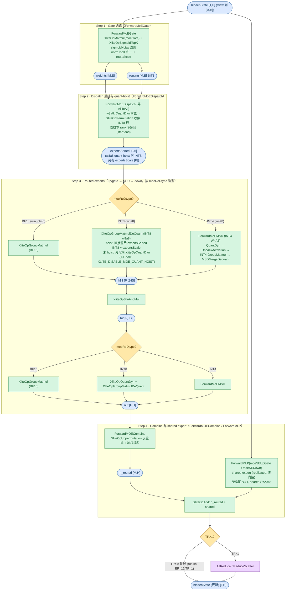

# GlmMoeDsaForCausalLM Forward 流程图

GLM-5 系列（`model_type=glm_moe_dsa`，HF 架构 `GlmMoeDsaForCausalLM`）在 xlite C++ 侧的前向流程。每层结构为 **MLA 低秩 KV 注意力 + DSA lightning indexer**（`attnType=AttnDSA`，`ForwardAttnMLAV2` 统一承载）+ **sigmoid MoE**（noaux_tc bias 选路、normTopK 归一、routeScale=2.5、shared expert）。GLM-5 系列三个发布版本 GLM-5 / 5.1 / 5.2 在 xlite 侧**完全同构**（checkpoint config 的 dim / 层数 / 专家数 / MLA 与 indexer 维度逐字段一致，均见下表 GLM-5 列），唯一结构差异：GLM-5.2 引入 `indexer_types`（full/shared 交错，DSA topk 跨层共享，见 §2），GLM-5 / 5.1 无该字段（全部层 full indexer）；量化变体 w8a8 / w4a8 / bf16 共用同一图，差异在 `ForwardLinear` 与 MoE expert 的量化分支。GLM-5.2-MTP（`glm_moe_dsa_mtp`）的 draft 层结构与主模型同构，走同一 `Forward`（MTP 部署由 vllm-ascend speculative 侧调度）。**GLM-5.3（非 Flash）architectures 同为 `GlmMoeDsaForCausalLM`**，按本系列对待（repo 内暂无 checkpoint / 测试接入）。**GLM-5.3-Flash 不属本图**（`glm5_next_text`，MHC 多流 + KDA 线性注意力 + 稀疏 MLA，C++ 前向尚未实现）。

**GLM-4.7 系列的区别**：GLM-4.7（`Glm4MoeForCausalLM` → 适配器 `Glm4MoeXliteModel`）是**标准 GQA MHA + MoE**（`attnType=AttnMHA`，不经过本图的任何 MLA 路径；MoE 打分同 sigmoid，见 [tests/run.sh](../../../tests/run.sh) 的 `run_glm4_moe`）；GLM-4.7-Flash（`Glm4MoeLiteForCausalLM`，`run_glm4_moe_flash`）注意力为 **MLA 无 DSA**（`attnType=AttnMLA`，走本图 §2 的 MLA 主干（Step 1 / Step 3）但**不调用 indexer**、无稀疏路径）。两者均与本系列共享 §3.2 的 MoE 结构。

**与 DeepSeek 系列的区别**：vs DeepSeek-V3（MLA，无 DSA）——同为 MLA + sigmoid MoE + shared expert，但无 indexer、attention 无稀疏分支；vs Qwen3（[Qwen3ForCausalLM.md](Qwen3ForCausalLM.md)）——GQA 标准注意力、MoE softmax 无 shared expert，与本图的 MLA+DSA+sigmoid+shared 完全不同。

配置依据（取自 [tests/run.sh](../../../tests/run.sh) 中的真实模型测试函数）：

| 变体 | run.sh 函数 / checkpoint | 部署 | 量化 | 关键参数 |
|------|--------------------------|------|------|----------|
| GLM-5（bf16） | `run_glm5` / **GLM-5** | TP=1 + EP=16（默认注释：bf16 需 32 NPU） | none | dim=6144, n_heads=64, q_lora_rank=2048, kv_lora_rank=512, qk_nope_head_dim=192, qk_rope_head_dim=64, v_head_dim=256, n_layers=78, n_dense_layers=3, inter_dim=12288, moe_inter_dim=2048, n_routed_experts=256, n_activated_experts=8, n_shared_experts=1, score_func=sigmoid, route_scale=2.5, index_n_heads=32, index_head_dim=128, index_topk=2048, indexer_rope_interleave=true, norm_eps=1e-5, BF16 |
| GLM-5-w8a8 | `run_glm5_w8a8` / **GLM-5-w8a8** | TP=1 + EP=16 | w8a8 | 同上；MLA 三投影 INT8 STATIC（inputScale/Offset/quantBias/deqScale 四元组），dense MLP / shared / routed expert INT8 动态量化 |
| GLM-5-w4a8 | `run_glm5_w4a8` / **GLM-5-w4a8** | TP=1 + EP=16 | w4a8 | 同上；routed expert INT4 MSD（W4A8），MLA / dense / shared 保持 INT8 动态量化 |
| GLM-4.7（对照，不属本图） | `run_glm4_moe` / **GLM-4.7** | TP=1 + EP=16 | none | GQA MHA + MoE sigmoid，`attnType=AttnMHA` |

> 下文数值示例以 **GLM-5-w8a8**（`run_glm5_w8a8`，EP=16/TP=1 per-rank 视角）为准。三个 `run_glm5*` 函数共用 `tests/generate.py` 的 `--model glm5` 入口（参考实现在 `tests/models/deepseek_v3.py`，`model_type=glm5` 时启用 DSA indexer），C++ 路径与生产 vllm-ascend 适配器 `DeepseekV32XliteModel`（`_supported_architectures` 含 `GlmMoeDsaForCausalLM`）接入的同一路径一致。

源码入口：[`csrc/model.cpp`](../../../csrc/model.cpp) `XModel::Forward` → `ForwardEmbedAndLayers`。

## 图例与记号

图例（节点形状与配色、箭头语义）统一见 [图示规范](../../conventions/diagram_conventions.md) §4，本文各节 mermaid 图内的 classDef 与规范一致。

### Shape 记号（per-rank / TP 切分后）

下图所有 shape 记号均为单卡（per-rank）视角。GLM-5-w8a8 部署 EP=16、TP=1，故注意力/MoE gate 维度不切分（`nH=64` 为全量），expert 权重按 EP 切分（`E_loc`）。下表以 **GLM-5-w8a8**（[tests/run.sh](../../../tests/run.sh) `run_glm5_w8a8`，EP=16/TP=1）为例给出取值：

| 记号 | 含义 | GLM-5-w8a8（EP=16, TP=1） |
|------|------|---------------------------|
| `T` | currTokens（当前步实际 token 数，运行时定，`T` ≤ `M`） | 运行时 |
| `M` | maxTokensDp：每步当前 token 数（DP>1 且 MoE 时为 DP pad 后行数），上界 = `max_seq_len·max_batch_size` | 1024·1 = 1024 |
| `B` | batch（rt._batch，运行时定） | 运行时 |
| `H` | hiddenSize（`dim`） | 6144 |
| `V` | vocabSize（lm_head 输出维，TP 切分） | 154880 |
| `nH` | nHeads / tp | 64 |
| `qLR` / `kvLR` | qLoraRank / kvLoraRank | 2048 / 512 |
| `noH` / `rH` / `vH` | qk_nope_head_dim / qk_rope_head_dim / v_head_dim | 192 / 64 / 256 |
| `qkvcD` | qLR+kvLR+rH（MLA 融合 QKVA 维，不切分） | 2624 |
| `qD` | MLA q 头输出总维 = nH·(noH+rH) | 16384 |
| `aD` | nH·kvLR（W_UK/W_UV 吸收后 latent 维） | 32768 |
| `oD` | nH·vH（MLA 输出头维合计） | 16384 |
| `idxNH` / `idxHD` | indexer 头数 / 头维（replicated 不切分） | 32 / 128 |
| `indexTopK` | indexer 稀疏选块数 | 2048 |
| `dInt` | dense MLP 中间维 = inter_dim / tp（前 nDense 层） | 12288 |
| `IS` | moeIntermediateSize / moeTPSize（routed expert） | 2048 |
| `sharedIS` | shared expert 中间维（replicated 不切分）= nSharedExperts·moeIntermediateSize | 1·2048 = 2048 |
| `E` | nRoutedExperts | 256 |
| `E_loc` | (E + numRedundantExperts) / moeEpSize（本 rank 物理专家段 `[start, end)` 长度） | 256/16 = 16 |
| `nA` | nActExperts | 8 |
| `P` | expertsSorted.shape[0] ≈ `M·nA`（dispatch 后本 rank token×专家总数） | M·8 |
| `blk` | blockSizes[0]（paged KV 块大小，xlite 后端 64） | 64 |
| `tile` | rt._tileSizeOfCachedKV（runtime 阈值，非 config 固定值） | runtime |

### 复合维度计算示例（GLM-5-w8a8, EP=16/TP=1）

| 复合维度（图中的表达式） | 展开式 | GLM-5-w8a8 |
|--------------------------|--------|------------|
| MLA 融合下投影 `qkvcD`（§2 `qkvc`） | qLora + kvLora + rope 三段拼接 | 2048+512+64 = **2624** |
| MLA q 上投影 `qD`（§2 `qWithQr`） | q 每头完整维（nope+rope） | 64·(192+64) = **16384** |
| MLA q rope 段 `nH·rH`（§2 `qPe`） | q 的 rope 部分 | 64·64 = **4096** |
| MLA 吸收后 `aD`（§2 `qAbsorb` / `oAbsorb`） | q 吸收 / 输出反吸收维 | 64·512 = **32768** |
| MLA attention 输出 `oD`（§2 `attnout`） | attention 输出 | 64·256 = **16384** |
| Indexer 融合 wk `idxHD+idxNH`（§2 `kw`） | wk 与 weights_proj 融合 | 128+32 = **160** |
| Indexer q 投影 `idxNH·idxHD`（§2 `qPtr`） | index query 投影 | 32·128 = **4096** |
| dense MLP `h13 [T, 2·dInt]` / `h2 [T, dInt]`（§3.1） | gate+up 拼接 / 中间激活 | [T, **24576**] / [T, **12288**] |
| MoE gate `weights` / `routing [M,E]`（§3.2） | token×专家打分 | [1024, **256**] |
| MoE expert `h13 [P, 2·IS]` / `h2 [P,IS]` / `out [P,H]`（§3.2） | gate+up 拼接 / 中间激活 / expert 输出 | [M·8, **4096**] / [M·8, **2048**] / [M·8, **6144**] |
| shared expert `h13 [T, 2·sharedIS]`（§3.2） | gate+up 拼接 | [T, **4096**] |
| MLA paged latent cache `[blkN, blk, 1, kvLR]`（§2 kCache，同层另有 peCache `[blkN, blk, 1, rH]` 与 indexKCache `[blkN, blk, 1, idxHD]`） | blkN = `max_seq_len/blk · max_batch` | [**16**, 64, 1, 512] / [16, 64, 1, 64] / [16, 64, 1, 128] |
| dense-gather 稀疏 KV `kDense [T, indexTopK, kvLR]` / `peDense [T, indexTopK, rH]`（§2） | 按 topk 收集的连续 cache | [T, 2048, 512] / [T, 2048, 64] |

> 图中所有 `[T,…]` 的 `T` 即 currTokens；MoE 内部 gate/combine 把 token pad 到 `M` 再做 permutation，故 §3.2 的 `weights` 标 `[M,E]`、`expertsSorted` 标 `[P,H]`（`P≈M·nA`）。MLA 的 `softmaxScale = (noH+rH)^-0.5 = 1/16`。

---

## 1. 顶层主循环

`Forward` → `ForwardEmbedAndLayers`：`hcMult==0` 恒成立（MHC 多流模型见 GLM-5.3-Flash / DeepSeek-V4 图，不画），`enableCommOptimize` 时改走 `ForwardLayersCommOptimize`（DP 对齐 pad 的层循环），GLM-5 测试默认 eager，下图按 `ForwardLayersNaive` 画。`deepstackNumLevel=0`（无 DeepStack 注入，相关 Add 跳过不画）。GLM-5 每层同构：attention 后残差+RMSNorm 进 FFN，FFN 后为下一层预归一化（末层则直接进最终 norm）；lm_head 由 `ForwardAndGetLogits` 串联 `ForwardGetLogits` 完成。

**关键点**：
- `x` 为全程残差基准（不更新），`h` 为工作张量 `[T,H]`，循环中原地改写；量化 checkpoint（w8a8 / w4a8）下各 RmsNorm / AddAndRmsNorm 附带 bias（`attnNormBias` 等由量化 checkpoint 提供），bf16 无。
- `ForwardAttn` 按 `attnType` 分发：GLM-5 为 `AttnDSA`，与 `AttnMLA`（GLM-4.7-Flash / DeepSeek-V3）同走 `ForwardAttnMLAV2`（§2）；`attnType` 只决定是否调用 indexer 与稀疏分支。
- `ForwardFFN`：`layer < nDenseLayers=3` → `ForwardMLP`（§3.1，稠密，`withAllReduce=true`）；`layer >= 3` → `ForwardMoE`（§3.2，75 层稀疏）。
- `ForwardGetLogits`：head 为 lm_head 权重，`V/TP` 切分；行数 > batch 时（prefill / DP pad）先按 indices 选行再投影。

---

## 2. Attention

单一层型（全层同构）：每层固定顺序执行 **Step 1 MLA 公共下投影 → Step 2 DSA indexer 选块 → Step 3 吸收、三路径 attention 与输出投影**，入口 `ForwardAttn` 按 `attnType` 分发（`AttnDSA` 与 `AttnMLA` 统一走 `ForwardAttnMLAV2`；GLM-4.7-Flash 为 `AttnMLA`，走 Step 1 + Step 3 但不调用 indexer、无稀疏分支）。indexer 是层内步骤而非层型差异：仅 full indexer 层执行 Step 2（`indexFullMask[i]`），GLM-5.2 的 shared 层跳过该步、跨层沿用最近 full 层 topk（配置差异，图 Step 2 菱形表达）。

**关键点**：
- **MLA 低秩结构**：`mlaQKVA` 把 hidden 压到 `[qLR | kvLR | rH]` 公共空间（`qkvcD`），`mlaQB` 上投影出每头 q；`mlaWUKT`/`mlaWUV`（来自 `wkv_b`）在 attention 前后做吸收 / 反吸收，KV cache 只存 `kvLR+rH=576` 维（vs 完整 KV `nH·(noH+rH+vH)`）。`ForwardLinear` 的 STATIC / DYNAMIC 量化 kernel 语义分别见 [quant.md](../kernels/quant.md) 与 [quant_dyn.md](../kernels/quant_dyn.md)。
- **MlaPrepare**（[mla_prepare.md](../kernels/mla_prepare.md)）：单 kernel 融合 q 段 RMSNorm（`mlaQNorm`+bias）、kv 段 RMSNorm（`mlaKVNorm`+bias）写 `kCache`、pe 段 complex RoPE（[rope_complex_and_cache.md](../kernels/rope_complex_and_cache.md)）写 `peCache`；`attnNormQc` 作为 `mlaQB` 与 Step 2 indexer q 投影的共同输入。
- **q rope**：`XliteOpRopeComplex` 只旋转 q 每头的 rope 段（`rH=64`，nope 段不动），输出独立的 `qPe`。
- **吸收 / 反吸收**：两处均为 `XliteOpEinsumMhtHtdMhd`（逐头 GEMM，[einsum_mht_htd_mhd.md](../kernels/einsum_mht_htd_mhd.md)）。qAbsorb 把 q 的 nope 段与 `mlaWUKT` 相乘折进 `kvLR` 维，使 attention 在 latent 空间计算；输出侧 oAbsorb 与 `mlaWUV` 相乘还原到 `vH`。`mlaWUKT`/`mlaWUV` 三变体均保持 BF16（不量化）。
- **indexer 权重融合**：checkpoint 的 `indexer.wk` 与 `indexer.weights_proj` 离线拼成 `indexKWeightsProj`（前 `idxHD` 列为 k，尾 `idxNH` 列为头权重）；`XliteOpIndexerPrepare`（[indexer_prepare.md](../kernels/indexer_prepare.md)）对 k 段做 LayerNorm + GPT-J 交错 RoPE（`indexRopeInterleaved=true` 为 GLM-5 必要条件，C++ 未实现非交错分支）写 `indexKCache`。
- **isLong 是 indexer 核心分支**：`maxNumBlocks·blk > indexTopK`（block 表容量超过 topk 上限）才执行 q 投影与 topk 选择；否则仅写 `indexKCache` 并返回 `nullptr`（attention 退化为全量）。GLM-5 测试 `max_seq_len=1024 < 2048` 恒走 `!isLong`；序列增长越过 2048 后才进入稀疏路径。
- **TopK 链**：`XliteOpIndexerTopK` 把 [indexer_scores.md](../kernels/indexer_scores.md)（Q·K 打分、ReLU、头权重融合）与 [indexer_topk.md](../kernels/indexer_topk.md)（跨核全局 topk、因果前缀限定）融合进同一 launch，输出 `dsaPerLayerTopk [T, indexTopK]`。
- **C8 可选路径**（`indexC8Mask[layer]`，部署配置）：GLM-5.1-w8a8c8 的 **LI-C8** 模式——启用时把 query 量化为 INT8、deq scale 折叠进 `scaledWeights`，`indexKCache` 也改存 INT8（[indexer_prepare_c8.md](../kernels/indexer_prepare_c8.md)、[quant_q_c8.md](../kernels/quant_q_c8.md)、[quant_cache_c8.md](../kernels/quant_cache_c8.md)）；LI-C8 仅可配置在 full indexer 层（`Init` 校验：`LI-C8 requires a full Indexer layer`）。测试侧经 config 的 `index_c8_mask` 传入（仅限 `forward_backend=xlite` 的 glm5 路径），run.sh 的三个函数均未启用（BF16 直传）；生产适配器侧 C8 接线尚为 TODO。
- **full / shared 交错（GLM-5.2 差异）**：`indexFullMask[i]` 为 false 的层（GLM-5.2 `indexer_types` 中 "shared"：层 0–2 为 full，其后每 4 层 1 个 full、3 个 shared，`index_topk_freq=4`）**跳过整个 Step 2**，attention 直接复用最近 full 层的 `dsaPerLayerTopk`（DSA topk 跨层共享，`rt.dsaPerLayerTopk` 持续指向 `_dsaTopkBuffer`，图上虚线）；这些层的 `indexQB`/`indexKWeightsProj`/`indexKCache` 为占位权重不参与计算。GLM-5 / 5.1 无 `indexer_types` 字段（mask 为空 → 全部层 full）。GLM-4.7-Flash（MLA 无 DSA）整个 indexer 不存在。
- **三条 attention 路径**（条件见 `ForwardAttnMLAV2`）：
  ① **dense-gather**——`attnType=DSA` 且 `topkIndices != nullptr`（indexer 长序列产出）且（block 表容量 `maxNumBlocks·blk > tile` 或 `> XLITE_MLA_DENSE_THRESHOLD(280)·batch`）且 `maxQueryLen <= XLITE_SMALL_PREFILL_THRESHOLD(6)`：`XliteOpGatherSparseKVCache`（[gather_sparse_kv_cache.md](../kernels/gather_sparse_kv_cache.md)）把稀疏 top-k token 收集成每 query 连续的 `kDense`/`peDense`，再 `XliteOpMLAV2` dense 模式计算。decode 恒满足（maxQueryLen=1）；MTP / 小 prefill 步长也可进入。
  ② **paged**——maxNumBlocks·blk `≤ tile`：直接在 paged cache 上算 `XliteOpMLAV2`（[mla_v2.md](../kernels/mla_v2.md)），`topkIndices` 非空时以 sparse mask 形式生效。prefill 与短序列 decode 走此路。
  ③ **flash**——其余（长序列且不满足 dense 条件）：`XliteOpFlashMLAV2`（[flash_mla_v2.md](../kernels/flash_mla_v2.md)）分块 online softmax，`topkIndices` 同样以 mask 生效。
  GLM-5 测试配置下 `max_seq_len=1024 < indexTopK=2048`，Step 2 恒走短序列，`topkIndices=nullptr`，dense-gather 不触发，实际按 block 表容量（`maxNumBlocks·blk`）在 ② / ③ 间切换。
- **TP>1 末尾通信**：`enableCommOptimize` 时 `ReduceScatter`，否则 `AllReduce`；GLM-5 测试 TP=1 跳过（EP 不切分注意力，`nH=64` 全量驻留每卡）。

---

## 3. FFN

`ForwardFFN` 按 layer 索引在**同一模型内**交错分发两种 FFN 层型（层型交错，非模型变体差异）：`layer < nDenseLayers=3` → `ForwardMLP`（§3.1 稠密）；`layer >= 3` → `ForwardMoE`（§3.2 稀疏，75 层）。`nDenseLayers=3` 取自 checkpoint `first_k_dense_replace`（适配器映射为 `n_dense_layers`），dense 层绑定 `mlpUpGate`（gate/up 融合）/ `mlpDown`（`inter_dim=12288`）。

### 3.1 稠密 MLP（前 3 层，ForwardMLP）

SwiGLU（`gate·silu(up)`）稠密层型，up/gate 与 down 两段 `ForwardLinear` 共用同一量化分发；`swigluLimit=0` 不 clamp。

**关键点**：
- GLM-5-w8a8（TP=1）：`dInt=12288` → `h13 [T,24576]`、`h2 [T,12288]`，仅前 3 层走此路（`withAllReduce=true`，TP=1 时跳过通信）；`swigluLimit=0` 不 clamp（GLM-5.3-Flash 为 10.0）。SiLU 融合语义见 [silu_and_mul.md](../kernels/silu_and_mul.md)。
- 量化对比：w8a8 / w4a8 的 dense 两段与 shared expert（§3.2）同为 INT8 DYNAMIC_QUANT（仅 deqScale）——与 w8a8 下 MLA 三投影的 STATIC_QUANT（静态四元组）不同；w4a8 仅 routed expert 走 INT4，dense 投影不变。

---

### 3.2 MoE（layer >= 3，ForwardMoE）

sigmoid 打分（`scoringFunc=SIGMOID`）+ noaux_tc bias（`gate_bias`，即 `e_score_correction_bias`，只引导选路不进权重）+ `normTopKProb` 归一 + `routeScale=2.5`；`nExpertGroups=1`/`nLimitedGroups=1`（无分组限制，`XliteOpSigmoidTopK` 的组约束退化）。**有 shared expert**（`nSharedExperts=1`，replicated 不分片、无 `moeSEGate` 门控——当前所有 GLM-5 接入路径均未绑定该权重，`XliteOpSigmoidGateMul` 跳过，routed 与 shared 直接相加）。无 EPLB 冗余专家（`numRedundantExperts=0`，`log2phy` 为空时 `XliteOpRemapGateOutputs`（[remap_gate_outputs.md](../kernels/remap_gate_outputs.md)）零开销跳过，不画菱形）。GLM-5-w8a8（EP=16/TP=1）：`E=256`、`E_loc=16`、`nA=8`、`IS=2048`（`moeTPSize=1`）。

**关键点**：
- **Gate**：`XliteOpMatmul(moeGate)` 打分后 `XliteOpSigmoidTopK`（[sigmoid_topk.md](../kernels/sigmoid_topk.md)）一次完成 sigmoid、bias 选路（noaux_tc：权重取 pre-bias 值）、top-`nA=8`、normTopK 归一与 routeScale 缩放，输出 `weights [M,E]` 与 BIT1 掩码 `routing [M,E]`。glm_moe_dsa 的 routing 按 FP32 计算（vllm 对该 model_type 强制 FP32 router，适配器把 `gate_bias` 转 FP32 传入）。
- **Dispatch（非 AllToAll）**：`enableMoEAllToAll=false`（run.sh / 默认；与 EPLB 互斥）走 `XliteOpPermutation`（[permutation.md](../kernels/permutation.md)），把 token 按 routing 重排为 expert 分组的 `expertsSorted [P,H]`。EP=16 时仅排本 rank 物理专家段 `[start, end)`（`start = rankId/moeTPSize · E_loc = rankId·16`）；`mAllDp >= 1024` 时预分配行数按 `activeTokensRatioPerEp` 压缩（`P ≤ M·nA`）。DP>1 时 dispatch 前另有打包 AllGather（`XliteOpConcat` → `AllGather` → `XliteOpSplit`，图中省略）。
- **w8a8 quant-hoist**（`moeReDtype==INT8` 且 `hiddenSize%32==0`，非 AllToAll / graph 通信，默认启用，w8a8 变体即走此路）：`XliteOpQuantDyn` 前置到 permutation 之前（per-token 量化 hiddenState），permutation 收集 INT8 行并把 per-token scale 搭带散射到对应专家槽，`expertsSorted` 为 INT8、另有 `expertsScale [P]` FP32（`expertsSorted` 缓冲减半、量化 M 行而非 P 行、DP>1 AllGather 载荷减半）；`XLITE_DISABLE_MOE_QUANT_HOIST` 可回退 legacy BF16 收集。
- **Expert 计算**：按 `moeReDtype` 三分支，up/gate 与 down 两段各自独立——BF16（`run_glm5`）直接 `XliteOpGroupMatmul`（[group_matmul.md](../kernels/group_matmul.md)）；INT8（w8a8）up/gate 段 quant-hoist 生效时直接 `XliteOpGroupMatmulDeQuant`（`expertsScale` 参与解量化），未 hoist（AllToAll / graph 通信 / 显式禁用）才段内 `XliteOpQuantDyn`；INT4（w4a8）走 `ForwardMoEMSD`（`XliteOpQuantDyn` → `XliteOpUnpackActivation`（[unpack_activation.md](../kernels/unpack_activation.md)）→ INT4 `XliteOpGroupMatmul` → `XliteOpMSDMergeDequant`（[msd_merge_dequant.md](../kernels/msd_merge_dequant.md)）三段式管线）。down 段 `h2` 恒段内 `QuantDyn`。
- **Combine + shared**：`ForwardMOECombine`（`XliteOpUnpermutation`，[unpermutation.md](../kernels/unpermutation.md)）把 `[P,H]` 按 `weights` 加权求和还原回 `[M,H]` 得 `h_routed`；shared expert 走 `ForwardMLP(moeSEUpGate/moeSEDown)`（结构同 §3.1、`sharedIS=2048`，replicated 每 rank 全量计算），`XliteOpAdd`（[add.md](../kernels/add.md)）相加写回 hiddenState。`moeSEGate` 非空时中间另有 `XliteOpMatmul(seGate)` + `XliteOpSigmoidGateMul` 标量门控（[sigmoid_gate_mul.md](../kernels/sigmoid_gate_mul.md)），GLM-5 未绑定不执行。
- **TP>1 末尾通信**：非 AllToAll 时 `AllReduce`（`enableCommOptimize` 时 `ReduceScatter`）。run.sh GLM-5 为 EP=16/TP=1，此步跳过。
