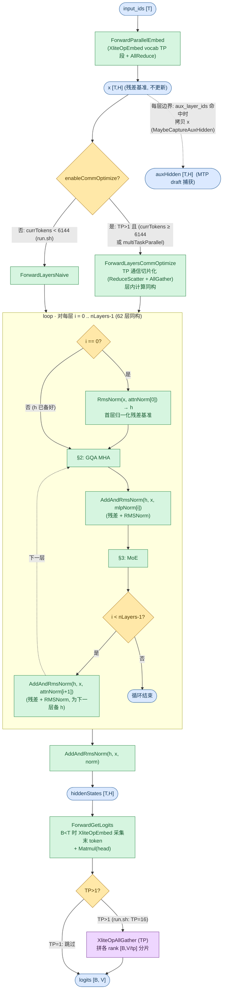
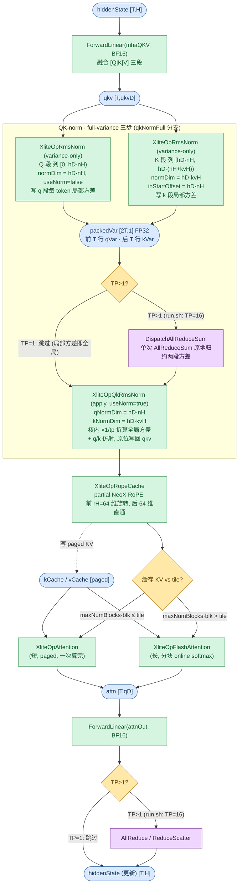
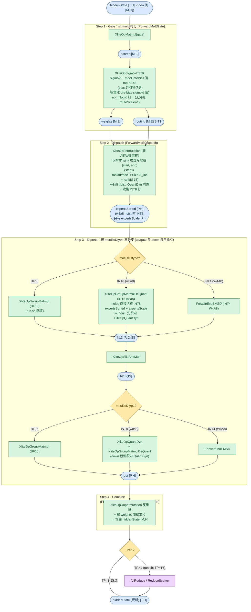

# MiniMaxM2ForCausalLM Forward 流程图

MiniMax-M2 系列（`model_type=minimax_m2`）在 xlite C++ 侧的前向流程。族内 MiniMax-M2 / M2.5 / M2.7 共用同一 `MiniMaxM2ForCausalLM` 架构（生产适配器按架构名挂接，见 [doc/user_guide/models.md](../../user_guide/models.md) 支持表），**全部层同构**：GQA 全注意力 + sigmoid MoE，无 dense/MoE 之分、无 hybrid 线性注意力层、无 shared expert。`run_minimax_m2` 以 **MiniMax-M2.7-bf16** 权重实测；本文数值均取自该 checkpoint 的 `config.json`（62 层、`attn_type_list` 全 1 即全注意力、`scoring_func=sigmoid` 且 `use_routing_bias=true`、`rotary_dim=64`、词表 200064 不 tie）。MTP（`num_mtp_modules=3`）是 vLLM 侧的 EAGLE3 draft 模型，不属于 C++ 主干 62 层。

**与 Qwen3 系列的区别**（同为 GQA 全注意力、融合 `[Q|K|V]` 无输出门控、normTopK 归一化、无 shared expert）集中在三处：

- **QK-norm 为 full-variance 式**：Qwen3 逐 head 按 `headDim` 归一化；MiniMax 把 Q 段（全部 q head 拼接）与 K 段（全部 kv head 拼接）各按**整段**计算方差，TP>1 时须先 AllReduceSum 归约各 rank 局部方差再归一化（见 §2）。
- **MoE 打分**：Qwen3 走 `XliteOpSoftmaxTopK`（softmax，不消费 gate bias）；MiniMax 走 `XliteOpSigmoidTopK`（sigmoid，DeepSeek-V2/V3 风格），消费 `e_score_correction_bias`——bias 只引导选路，路由权重取 pre-bias sigmoid 值（见 §3）。
- **Partial RoPE**：Qwen3 全维（`ropeHeadDim=headDim`）；MiniMax 仅前 `rotary_dim=64=headDim/2` 维旋转，后 64 维直通（见 §2）。

配置依据（取自 [tests/run.sh](../../../tests/run.sh) 中的真实模型测试函数）：

| 变体 | run.sh 函数 / 模型 | 部署 | FFN | 关键参数 |
|------|--------------------|------|-----|----------|
| MiniMax-M2.5 / M2.7（同架构） | `run_minimax_m2` / **MiniMax-M2.7-bf16** | TP=16 + EP=16（`moe_ep_size=16, moe_tp_size=1`，torchrun 16 卡） | 全 MoE（`n_dense_layers=0` 硬编码） | dim=3072, head_dim=128, rotary_dim=64, n_heads=48, n_kv_heads=8(GQA), n_layers=62, moe_inter_dim=1536, n_routed_experts=256, n_activated_experts=8, norm_topk_prob=True, sigmoid 打分 + e_score_correction_bias, qk_norm_full=True, norm_eps=1e-6, rope_theta=5e6, BF16 |

> 下文数值示例以 **MiniMax-M2.7** 为准（TP=16 per-rank 视角，EP=16）。run.sh 测试只写 `moe_ep_size/moe_tp_size/dtype/max_batch_size/max_seq_len` 五项，其余取 [tests/models/minimax_m2.py](../../../tests/models/minimax_m2.py) 的 `ModelArgs` 默认值（与 M2.7 HF config 一致）；`max_seq_len=1024 / max_batch_size=1` 为测试精简规格（发布 `max_position_embeddings=196608`），下文 paged KV 与 `M` 上界按测试配置统计。`run_minimax_m2` 自带 xlite 后端（测试 transformer 复用 [tests/models/glm4_moe.py](../../../tests/models/glm4_moe.py) 的参考实现，其 `qk_norm_full` / sigmoid 路由分支即 MiniMax 语义）；生产路径由 vllm-ascend 适配器 `MiniMaxM2XliteModel`（`vllm_ascend/xlite/xlite.py`）接入。

源码入口：[`csrc/model.cpp`](../../../csrc/model.cpp) `XModel::Forward` / `ForwardAndGetLogits` → `ForwardEmbedAndLayers`；lm_head 由 `ForwardGetLogits` 完成（`ForwardAndGetLogits` 在层循环后接续调用，亦可作独立 `FORWARD_GET_LOGITS` 任务）。

## 图例与记号

图例（节点形状与配色、箭头语义）统一见 [图示规范](../../conventions/diagram_conventions.md) §4，本文各节 mermaid 图内的 classDef 与规范一致。

### Shape 记号（per-rank / TP 切分后）

下图所有 shape 记号均为单卡（per-rank）视角，全部取自图示规范 §4 全局表。`tp_size>1` 时带 `/tp` 的记号按 TP 切分，`kvH` 不足时复制；MoE 专家按 EP 切分（`E_loc`）。

| 记号 | 含义 | MiniMax-M2.7（TP=16 + EP=16） |
|------|------|-------------------------------|
| `T` | currTokens（当前步实际 token 数，运行时定，`T` ≤ `M`） | 运行时 |
| `M` | maxTokensDp（DP>1 且 MoE 时为 DP pad 后行数），上界 = `max_num_batched_tokens` = `max_seq_len·max_batch_size`（测试配置） | ≤1024 |
| `H` | hiddenSize（`dim`） | 3072 |
| `nH` | nHeads / tp | 3 |
| `kvH` | nKvHeads / tp（GQA，≥1，不足复制） | 1 |
| `hD` | headDim | 128 |
| `rH` | ropeHeadDim（`rotary_dim`，partial 旋转维） | 64 |
| `qD` | nH·hD（q / o 投影维） | 384 |
| `qkvD` | (nH+2·kvH)·hD（融合 QKV 维） | 640 |
| `IS` | moeIntermediateSize / moeTPSize（MoE expert，`moe_tp_size=1` 不切分） | 1536 |
| `E` | nRoutedExperts | 256 |
| `E_loc` | E / moeEpSize（本 rank 物理专家段 `[start, end)` 长度） | 16 |
| `nA` | nActExperts | 8 |
| `P` | expertsSorted.shape[0] ≈ `M·nA`（dispatch 后 token×专家总数） | M·8 |
| `blk` | blockSizes[0]（paged KV 块大小） | 128 |
| `B` | batch（rt._batch，运行时定） | 运行时 |
| `V` | vocabSize（head 输出维，TP 切分） | 200064 |

### 复合维度计算示例

| 复合维度（图中的表达式） | 展开式 | MiniMax-M2.7（TP=16 + EP=16） |
|--------------------------|--------|-------------------------------|
| MHA 融合 QKV `qkvD = (nH+2·kvH)·hD`（§2 `qkv`） | q+k+v 拼接（无输出门控段） | (3+2)·128 = **640** |
| MHA q/o 维 `qD = nH·hD`（§2 `attn`） | q 投影维 | 3·128 = **384** |
| QK-norm Q 段 `hD·nH`（§2，全局 `hD·nHeads`） | full-variance 归一化范围 | 384（全局 **6144**） |
| QK-norm K 段 `hD·kvH`（§2，全局 `hD·nKvHeads`） | 同上 | 128（全局 **1024**） |
| QK-norm 方差缓冲 `packedVar [2T,1]`（§2） | 前 `T` 行 qVar · 后 `T` 行 kVar（FP32） | [2T, 1] |
| MoE gate `weights/routing [M,E]`（§3） | token×专家打分 | [M, **256**] |
| MoE expert `h13 [P, 2·IS]`（§3） | gate+up 拼接 | [M·8, **3072**] |
| MoE expert `h2 [P,IS]` / `out [P,H]`（§3） | 中间激活 / expert 输出 | [M·8, **1536**] / [M·8, **3072**] |
| lm_head 分片 `V/tp`（§1 `logits`） | head 权重按 vocab TP 切分，AllGather 拼回 | 200064/16 = **12504** |
| paged KV cache / 层 `[blkN, blk, kvH, hD]`（k 同 v） | blkN = `max_seq_len/blk · max_batch`（测试配置） | [8, 128, 1, 128] |

---

## 1. 顶层主循环

`ForwardEmbedAndLayers` 在 `hcMult==0`（MiniMax 恒成立，不画 MHC 分支）时按 `enableCommOptimize` 二选一层循环实现，层内计算同构；`ForwardAttn` 按 `attnType` 分发，非 hybrid 的 `AttnMHA` 恒走 `ForwardAttnMHA`（§2）。恒走一条路、不画菱形的还有：`ForwardFFN` 的 `layer < nDenseLayers` 恒假（`n_dense_layers=0`，62 层全 MoE，`§3: MoE` 占位节点即 §3）；DeepStack 注入仅 Qwen3-VL 类模型存在（`deepstackNumLevel=0` 跳过）。

**关键点**：

- `x` 为全程残差基准（不更新），`h` 为工作张量 `[T,H]`，循环中原地改写；层结构「Attention → 残差+RMSNorm → MoE → 残差+RMSNorm」交替，与 Qwen3 相同。
- **全层 MoE**：`n_dense_layers=0`（适配器与测试两侧硬编码），FFN 恒展开为 `ForwardMoE`（§3），无 Qwen3 dense 变体的 `ForwardMLP` 路径；MoE 权重 BF16 走 NO_QUANT（run.sh 配置）。
- **lm_head**：`B < T`（如 prefill）时先 `XliteOpEmbed` 按 `indices` 采集每 request 末 token 行得 `[B,H]`，`B == T`（decode）时跳过；`Matmul(head)` 输出本 rank `[B, V/tp]` 分片，TP>1 时 AllGather 拼成 `[B, V]`。
- MTP（`use_mtp=true, num_mtp_modules=3`）在 vLLM 侧以 EAGLE3 方式运行，不在 62 层主干内；xlite 经 `aux_layer_ids`（`MaybeCaptureAuxHidden`）按层拷贝 `x` 为 draft 捕获中间层隐状态。

---

## 2. Attention

**全层同型**：62 层全部为 GQA MHA（full-variance QK-norm + partial RoPE `rotary_dim=64`），`ForwardAttn` 按 `attnType=AttnMHA` 恒分发 `XModel::ForwardAttnMHA`（`attn_type_list` 全 1，非 hybrid，无逐层 attnType 分支），权重 BF16 走 NO_QUANT；融合 QKV 权重 layout 为 `[Q|K|V]` 三段（`qkv_bias=False`、无 Qwen3.5 式输出门控段，故无 SplitCol / SigmoidGateMul 步骤）。下图即该唯一层型的完整链路（QKV 投影 → QK-norm → partial RoPE + KV 写缓存 → attention → o 投影 → TP 通信）。

**关键点**：

- **QK-norm 为 full-variance 式（与 Qwen3 逐 head QK-norm 的差异）**：MiniMax 在**整段 Q / 整段 K** 上求方差（HF 参考实现：`q_norm = RMSNorm(head_dim·num_attention_heads)` 全局 6144、`k_norm = RMSNorm(head_dim·num_key_value_heads)` 全局 1024）；Qwen3 逐 head 按 `headDim` 归一化，单 kernel、TP 无额外通信。`qkNormFull` 与 plain qkNorm 路径互斥：MiniMax 恒走本路径（`qk_norm_full=True` 硬编码），Qwen3 恒走 plain 路径（`qkNorm && !qkNormFull`）。
- **局部方差**：两次 `XliteOpRmsNorm`（`useNorm=false`，只算方差不归一化）分别对 Q 段（`normDim=hD·nH=384`）与 K 段（`normDim=hD·kvH=128`，`inStartOffset=hD·nH`）计算每 token 局部 mean-of-squares，写入 `packedVar` 前后两半（`kLocalVariance` 以字节偏移挂同一缓冲）。
- **单次通信**：`DispatchAllReduceSum` 对整个 `packedVar` 做一次 TP 组 AllReduceSum，q/k 两段方差同时归约（代码注释 "Single AllReduceSum over the packed buffer reduces both variances in place"）；各 rank 局部均值之和恰为 `tp×全局均值`（Q 段不重叠均分显然成立；K 段 kv head 复制时同样成立），故 apply 阶段核内 `×1/tpSize`（[norm.md](../kernels/norm.md) 的 `divTpSize`）即还原全局方差——与 vLLM `MiniMaxText01RMSNormTP` 的 allreduce + `var/tp_world` 语义一致。TP=1 时该步跳过。
- **apply**：`XliteOpQkRmsNorm`（`useNorm=true` + 预归约方差）单次 kernel 把 q/k 两段归一化结果**原位写回** `qkv`（见 [qk_rms_norm.md](../kernels/qk_rms_norm.md)）；仿射权重 `mhaQNorm` / `mhaKNorm`（`q_norm.weight [6144]` 按 TP 切 16 份，每 rank 384；`k_norm.weight [1024]` 按 `nKvHeads=8` 切，每片 128、相邻 2 rank 复制同一切片）。
- **Partial RoPE**：`rH = rotary_dim = 64 = headDim/2`（`partial_rotary_factor=0.5`），NeoX 风格非交错、`rope_theta=5e6`；`XliteOpRopeCache` 同时完成 q/k 的 RoPE 与 paged KV cache 写入（前 64 维旋转、后 64 维直通入缓存）。Qwen3 为全维（`ropeHeadDim=headDim`）。
- **GQA 复制**：`kvH = max(nKvHeads/tp, 1) = 1`（TP=16 > n_kv_heads=8，每 2 个 rank 复制同一 kv head）。
- **attention tile 分支**：`maxNumBlocks` = block table 列数 = `max_seq_len/blk`（测试配置 1024/128 = **8**）；`tile = rt._tileSizeOfCachedKV` 为 runtime 阈值。长路径按 tile 分块维护 online softmax（max/sum/lastMax/lastSum FP32 状态）。
- **TP>1 末尾通信**：`enableCommOptimize` 时 `ReduceScatter`，否则 `AllReduce`；TP=1 跳过（run.sh TP=16，执行）。

---

## 3. FFN

**全层同型**：62 层 FFN 全部为 MoE（`ForwardFFN` 的 `layer < nDenseLayers` 恒假——`n_dense_layers=0` 适配器与测试两侧硬编码，无 dense 前层；`n_shared_experts=0` / checkpoint `shared_intermediate_size=0`，无 shared expert），入口恒为 `XModel::ForwardMoE`：gate（sigmoid 打分消费 `e_score_correction_bias`，bias 只引导选路、路由权重取 pre-bias sigmoid 值；无分组路由）→ dispatch → experts → combine。以 **MiniMax-M2.7**（TP=16+EP=16）为例：`IS=1536`（`moe_tp_size=1`，expert 权重不按 TP 切分）、`E=256`、`E_loc=16`、`nA=8`。下图即该唯一层型的完整链路。

**关键点**：

- **恒定项（不画分支）**：`norm_topk_prob=True`（normTopK 归一）；无分组路由（`n_group=topk_group=1`）、`routeScale=1`；无 EPLB 冗余专家（gate 后 log→physical 重映射 `XliteOpRemapGateOutputs` 零开销跳过）。
- **打分 dtype**：`XliteOpSigmoidTopK` 语义见 [sigmoid_topk.md](../kernels/sigmoid_topk.md)；生产 vLLM `GateLinear` 为 FP32，run.sh 测试为 BF16（核内 FP32 计算）；`_gateIndices` 为 host 侧预置 `[0..E)` 恒等索引表。
- **e_score_correction_bias 加载**：生产适配器从 `block_sparse_moe.e_score_correction_bias` 捕获（`_decoder_layer_mlp_module="block_sparse_moe"`，即代码 "for MiniMax-2.x compatibility" 的回落名——vLLM 把 bias 注册在 MoE 块上而非 gate 下）并转 FP32；`moeGateBias` 由 sigmoid（及 sqrtsoftplus）分支消费，softmax 分支不消费。
- **Dispatch**：`enableMoEAllToAll=false`（run.sh / 默认）走 `XliteOpPermutation` 重排为 expert 分组的 `expertsSorted`（`mAllDp ≥ 1024` 时按 `activeTokensRatioPerEp` 压缩预分配行数）；DP=1（run.sh）无 dispatch 前的 `XliteOpConcat → AllGather → XliteOpSplit` 打包分发（DP>1 时有，图中省略）。
- **w8a8 quant-hoist**（`moeReDtype==INT8` 且 `hiddenSize%32==0`，非 AllToAll / graph 通信，默认启用）：`XliteOpQuantDyn` 前置到 permutation 之前（per-token 量化 hiddenState），permutation 收集 INT8 行并把 per-token scale 搭带散射到对应专家槽，`expertsSorted` 为 INT8、另有 `expertsScale [P]` FP32（`expertsSorted` 缓冲减半、量化 M 行而非 P 行、DP>1 AllGather 载荷减半）；`XLITE_DISABLE_MOE_QUANT_HOIST` 可回退 legacy BF16 收集。
- **Expert 分支取值**：BF16 = run.sh 测试；INT8 = w8a8（hoist 失效条件：AllToAll / graph 通信 / 显式禁用）；INT4 = W4A8 `ForwardMoEMSD`；中间 `XliteOpSiluAndMul` 做 SwiGLU 激活（见 [silu_and_mul.md](../kernels/silu_and_mul.md)）；`XliteOpGroupMatmul` 语义见 [group_matmul.md](../kernels/group_matmul.md)。
- **Combine**：`nSharedExperts=0`，不进入 `h_routed + sigmoid(se_gate)·shared(x)` 路径（GLM-4.x / DeepSeek 系列在此另有 shared expert 计算）；DP>1 时 Unpermutation 后接 DP `ReduceScatter`（图中省略）。
- **TP>1 末尾通信**：非 AllToAll 时 `AllReduce`（`enableCommOptimize` 时 `ReduceScatter`）；run.sh 为 TP=16+EP=16，此步执行。
