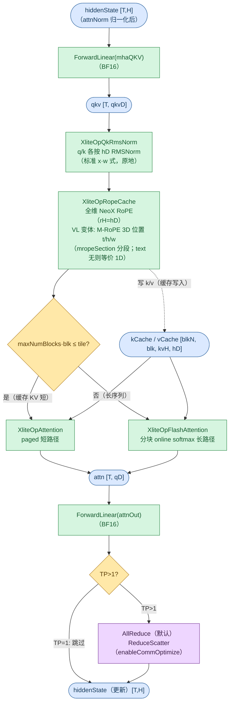

# Qwen3ForCausalLM Forward 流程图

Qwen3 系列（`model_type=qwen3` / `qwen3_moe`）在 xlite C++ 侧的前向流程。两个变体共享**标准 GQA MHA** 架构（`attn_type=AttnMHA`，每层同构），区别仅在 FFN：dense 变体全层稠密 MLP，MoE 变体全层 MoE。Qwen3-VL 系列（`Qwen3VLForConditionalGeneration` / `Qwen3VLMoeForConditionalGeneration`）的 text decoder 与本系列同构，视觉编码在 vLLM 侧完成，差异仅两处：**M-RoPE**（3D 位置，§2）与 **DeepStack**（前 K 层视觉特征注入，§1）。

**与 Qwen3.5 系列的区别**（见 [Qwen3_5ForConditionalGeneration.md](Qwen3_5ForConditionalGeneration.md)，Qwen3.6/3.8 亦归该系列）：无 hybrid 线性注意力层（每层都是 full attention）、无 attention 输出门控（QKV 融合权重只有 `[Q|K|V]` 三段）、RoPE 全维（`rope_head_dim=head_dim`，无 partial）、QK-norm 为标准 `x*w` 式（无 Gemma `x*(1+w)` 加载转换）。

配置依据（取自 [tests/run.sh](../../../tests/run.sh) 中的真实模型测试函数）：

| 变体 | run.sh 函数 / 模型 | 部署 | FFN | 关键参数 |
|------|--------------------|------|-----|----------|
| `qwen3`（dense） | `run_qwen3_32B` / **Qwen3-32B** | TP=8（torchrun 8 卡） | 全 dense MLP（`n_dense_layers=n_layers=64`） | dim=5120, head_dim=128, n_heads=64, n_kv_heads=8(GQA), n_layers=64, inter_dim=25600, norm_eps=1e-6, rope_theta=1e6, BF16 |
| `qwen3_moe` | `run_qwen3_moe_30B` / **Qwen3-30B-A3B-Instruct-2507** | TP=8 + EP=8（`moe_ep_size=8, moe_tp_size=1`） | 全 MoE（`n_dense_layers=0`） | dim=2048, head_dim=128, n_heads=32, n_kv_heads=4(GQA), n_layers=48, moe_inter_dim=768, n_routed_experts=128, n_activated_experts=8, norm_topk_prob=True, BF16 |

> 下文数值示例以 **Qwen3-32B**（dense 代表）与 **Qwen3-30B-A3B**（MoE 代表）为准（TP=8 per-rank 视角；MoE 变体 EP=8）。`run_qwen3_32B` 走 torch_npu 参考实现（C++ 路径由生产 vllm-ascend 适配器 `StandardXliteModel` 接入）；`run_qwen3_moe_30B` 自带 xlite 后端。

源码入口：[`csrc/model.cpp`](../../../csrc/model.cpp) `XModel::Forward` → `ForwardEmbedAndLayers`；lm_head 段见 §1（`ForwardAndGetLogits` = Forward 主干 + `ForwardGetLogits`）。

## 图例与记号

图例（节点形状与配色、箭头语义）统一见 [图示规范](../../conventions/diagram_conventions.md) §4，本文各节 mermaid 图内的 classDef 与规范一致。

### Shape 记号（per-rank / TP 切分后）

下图所有 shape 记号均为单卡（per-rank）视角。`tp_size>1` 时带 `/tp` 的记号按 TP 切分，`kvH` 不足时复制（`n_kv_heads < tp` → `kvH=1`）；MoE 专家按 EP 切分（`E_loc`）。

| 记号 | 含义 | Qwen3-32B（dense, TP=8） | Qwen3-30B-A3B（MoE, TP=8+EP=8） |
|------|------|--------------------------|--------------------------------|
| `T` | currTokens（当前步实际 token 数，运行时定，`T` ≤ `M`） | 运行时 | 运行时 |
| `M` | maxTokensDp：每步当前 token 数（DP>1 且 MoE 时为 DP pad 后行数），上界 = `max_num_batched_tokens` = `max_seq_len·max_batch_size` | ≤1024 | ≤65536 |
| `H` | hiddenSize（`dim`） | 5120 | 2048 |
| `nH` | nHeads / tp | 8 | 4 |
| `kvH` | nKvHeads / tp（GQA，≥1，不足复制） | 1 | 1 |
| `hD` | headDim | 128 | 128 |
| `qD` | nH·hD（q / o 投影维） | 1024 | 512 |
| `qkvD` | (nH+2·kvH)·hD（融合 QKV 维） | 1280 | 768 |
| `IS` | intermediateSize / tp（dense MLP）；moeIntermediateSize / moeTPSize（MoE expert） | 3200 | 768 |
| `E` | nRoutedExperts | —（无 MoE） | 128 |
| `E_loc` | E / moeEpSize（本 rank 物理专家段 `[start, end)` 长度） | — | 16 |
| `nA` | nActExperts | — | 8 |
| `P` | expertsSorted.shape[0] ≈ `M·nA`（dispatch 后 token×专家总数） | — | M·8 |
| `blk` | blockSizes[0]（paged KV 块大小） | 128 | 128 |
| `B` | batch（rt._batch，运行时定） | 运行时 | 运行时 |

### 复合维度计算示例

| 复合维度（图中的表达式） | 展开式 | Qwen3-32B（dense） | Qwen3-30B-A3B（MoE） |
|--------------------------|--------|--------------------|-----------------------|
| MHA 融合 QKV `qkvD = (nH+2·kvH)·hD`（§2 `qkv`） | q+k+v 拼接 | (8+2)·128 = **1280** | (4+2)·128 = **768** |
| MHA q/o 维 `qD = nH·hD`（§2 `attn`） | q 投影维 | 8·128 = **1024** | 4·128 = **512** |
| dense MLP `h13 [T, 2·IS]`（§3.1） | gate+up 拼接 | [T, **6400**] | —（无 dense MLP 层） |
| dense MLP `h2 [T, IS]`（§3.1） | 中间激活 | [T, **3200**] | — |
| MoE gate `weights/routing [M,E]`（§3.2） | token×专家打分 | — | [M, **128**] |
| MoE expert `h13 [P, 2·IS]`（§3.2） | gate+up 拼接 | — | [M·8, **1536**] |
| MoE expert `h2 [P, IS]` / `out [P,H]`（§3.2） | 中间激活 / expert 输出 | — | [M·8, **768**] / [M·8, **2048**] |
| paged KV cache / 层 `[blkN, blk, kvH, hD]`（k 同 v） | blkN = `max_seq_len/blk · max_batch` | [8,128,1,128] | [512,128,1,128] |

---

## 1. 顶层主循环

`Forward` → `ForwardEmbedAndLayers` → `ForwardLayersNaive` 逐层循环（`hcMult==0` 恒成立，不画 MHC 分支，多流模型见 GLM-5.3-Flash / DeepSeek-V4 图）；Qwen3 每层同构，无 Qwen3.5 的 hybrid 层分发。`enableCommOptimize` 时改走 `ForwardLayersCommOptimize`（差异见末尾要点）。lm_head 段仅 `ForwardAndGetLogits` 入口执行，`Forward` 入口止于 output [T,H]。

```mermaid
flowchart TB
  classDef tensor fill:#dbe9ff,stroke:#3b6ea8,color:#163a5f
  classDef op     fill:#d6f5e0,stroke:#2e8a4a,color:#155a2e
  classDef dec    fill:#ffe8a8,stroke:#b8862e,color:#5a3a00
  classDef comm   fill:#eed6ff,stroke:#7a3a9a,color:#3a1e4a

  in(["input_ids [T]"]):::tensor
  embed["ForwardParallelEmbed<br/>XliteOpEmbed（vocab 按 TP 切片）<br/>TP>1: AllReduce(TP)"]:::op
  x(["x [T,H]<br/>（残差基准，不更新）"]):::tensor

  subgraph loop ["loop · 对每层 i = 0 .. nLayers-1"]
    direction TB
    first{"i == 0?"}:::dec
    norm0["XliteOpRmsNorm(x, attnNorm[0]) → h<br/>首层归一化残差基准"]:::op
    attn["ForwardAttnMHA（见 §2: GQA MHA）"]:::op
    addrms["XliteOpAddAndRmsNorm<br/>(h, x, mlpNorm[i])<br/>残差回收 + 归一化"]:::op
    ffn{"layer < nDenseLayers?"}:::dec
    mlp["ForwardMLP（见 §3.1）"]:::op
    moe["ForwardMoE（见 §3.2）"]:::op
    ds{"i < deepstackNumLevel?"}:::dec
    dsadd["XliteOpAdd(h,<br/>deepstackInputEmbeds[i])"]:::op
    nxt{"i < nLayers-1?"}:::dec
    addnext["XliteOpAddAndRmsNorm<br/>(h, x, attnNorm[i+1])"]:::op

    first -- "是" --> norm0 --> attn
    first -- "否（h 已由上轮末尾备好）" --> attn
    attn --> addrms --> ffn
    ffn -- "是（dense: nDenseLayers=nLayers）" --> mlp
    ffn -- "否（moe: nDenseLayers=0）" --> moe
    mlp --> ds
    moe --> ds
    ds -- "是（仅 Qwen3-VL）" --> dsadd --> nxt
    ds -- "否（text: deepstackNumLevel=0）" --> nxt
    nxt -- "是" --> addnext
  end

  finalnorm["XliteOpAddAndRmsNorm(h, x, norm)"]:::op
  out(["output [T,H]"]):::tensor
  ldec{"B < M?"}:::dec
  gather["XliteOpEmbed(indices, output)<br/>按 indices 取 B 个采样行"]:::op
  head["XliteOpMatmul(·, head)<br/>lm_head（V 按 TP 切分）"]:::op
  lloc(["logits_local [B, V/tp]"]):::tensor
  ltp{"TP>1?"}:::dec
  ag["XliteOpAllGather(TP)"]:::comm
  logits(["logits [tp, B, V/tp]"]):::tensor

  in --> embed --> x --> loop
  loop -- "否（末层，出循环）" --> finalnorm --> out
  out --> ldec
  ldec -- "是" --> gather --> head
  ldec -- "否（每序列单 token）" --> head
  head --> lloc --> ltp
  ltp -- "TP=1: 跳过" --> logits
  ltp -- "TP>1" --> ag --> logits
  addnext -.->|"下一层 h"| attn
```

**关键点**：
- `x` 为全程残差基准（不更新），`h` 为工作张量 `[T,H]`，循环中原地改写；层内残差回收与归一化由 `XliteOpAddAndRmsNorm` 单算子完成。
- dense 变体全层走 §3.1、MoE 变体全层走 §3.2（`decoder_sparse_step=1`，无 MLP/MoE 混合层）。
- lm_head：`head` 为 vocab-parallel 权重，per-rank 输出 `[B, V/tp]`，AllGather 沿 TP 拼回完整 logits；`B < M` 时先按 `indices` 采样出 B 行再投影（M 行含 DP pad / prefill 多 token）。
- `enableCommOptimize` 时改走 `ForwardLayersCommOptimize`：token 数 pad 到 TP 倍数，attn/FFN 末尾的 TP AllReduce 换成 ReduceScatter + AllGather（两种通信形态已在 §2/§3 图的 TP 菱形合并标注）。
- **DeepStack 注入**（仅 Qwen3-VL，图中 ds 菱形）：前 `deepstackNumLevel`（= `len(deepstack_visual_indexes)`）层在 FFN 后 `XliteOpAdd` 注入 `deepstackInputEmbeds[i]`；text 模型为 0，恒跳过。
- Qwen3-VL 的视觉编码在 vLLM 侧执行，输出经投影后作为 `deepstackInputEmbeds` 与 input embeds 传入 C++ `Forward`；`ForwardWithInputsEmbeds` 入口直接从 embeds 进主循环（跳过 XliteOpEmbed），上图自 `input_ids` 起为 text 侧视角。

---

## 2. Attention

全系列只有一种层型：**GQA MHA**（QK-norm + 全维 RoPE），入口 `ForwardAttn` 对 `AttnMHA` 恒分发 `ForwardAttnMHA`，dense / MoE / VL 变体的 text 层同走此路，无 per-layer 分发；Qwen3-VL 差异仅在位置 id 计算（M-RoPE 3D 位置，图中 rope 节点注记），DeepStack 注入属嵌入侧（§1），不在 attention 层内。层内链路（输入为 §1 层循环 `attnNorm` 归一化后的 `h [T,H]`）：融合 QKV 投影（无 bias）→ QK-norm → 全维 RoPE（同时写 paged KV cache）→ attention 长短路径二选一 → o 投影 + TP 通信。权重 BF16 走 NO_QUANT（`ForwardLinear` 量化分支见 §3.1，本系列不走）。

**关键点**：
- QKV 投影无 bias（`qkv_bias=False`）；无输出门控故无 SplitCol（区别见概述段）。
- QK-norm：`qk_norm=True`、`qkNormFull=False`，q/k 各按 `hD=128` 归一化并原地改写 qkv。
- 全维 RoPE：`rH=hD=128`（无 partial），NeoX 非交错；`XliteOpRopeCache` 同时完成 q/k 旋转与 paged cache 写入（虚线）。
- M-RoPE（仅 Qwen3-VL）：位置为 3D（时间 t / 高度 h / 宽度 w），由 `mropeSection` 分段；构造期生成 `mropeMaskH/W` 位置掩码传入 `XliteOpRopeCache`（rope 节点注记）。text-only 的 qwen3/qwen3_moe 无 `mropeSection`，等价普通 1D RoPE。
- GQA 复制：`kvH = max(nKvHeads/tp, 1)`，两个举例模型均 `kvH=1`（n_kv_heads 8/4 < TP=8）。
- tile 判据：`maxNumBlocks` = block table 列数 = `max_seq_len/blk`（两举例模型均 8）；`tile` 为 runtime 阈值（`rt._tileSizeOfCachedKV`）。短路径一次性载入全部缓存 KV，长路径按 tile 分块 online softmax。
- TP>1 末尾：`enableCommOptimize` → `ReduceScatter`，否则 `AllReduce`；TP=1 跳过。

---

## 3. FFN

`ForwardFFN` 按 `layer < nDenseLayers` 分发（§1 ffn 菱形）。FFN 两种层型即系列内模型变体差异（同一模型内无交错）：dense 模型（`Qwen3ForCausalLM` / `Qwen3VLForConditionalGeneration`，适配器 `StandardXliteModel`，`nDenseLayers=nLayers`）全层走 §3.1 `ForwardMLP`；MoE 模型（`Qwen3MoeForCausalLM` / `Qwen3VLMoeForConditionalGeneration`，适配器 `QwenMoeXliteModel` 设 `n_dense_layers=0`）全层走 §3.2 `ForwardMoE`。

### 3.1 dense MLP（ForwardMLP）

SwiGLU（`gate·silu(up)`），up/gate 与 down 两投影共用 `ForwardLinear` 量化分支。

```mermaid
flowchart LR
  classDef tensor fill:#dbe9ff,stroke:#3b6ea8,color:#163a5f
  classDef op     fill:#d6f5e0,stroke:#2e8a4a,color:#155a2e
  classDef dec    fill:#ffe8a8,stroke:#b8862e,color:#5a3a00
  classDef comm   fill:#eed6ff,stroke:#7a3a9a,color:#3a1e4a

  h(["h [T,H]"]):::tensor
  q1{"up_gate 权重 dtype?"}:::dec
  mm1["XliteOpMatmul<br/>（NO_QUANT）"]:::op
  dq1["XliteOpQuantDyn → xQuanted [T,·] INT8<br/>+ scale [T] FP32<br/>→ XliteOpMatmulDeQuant<br/>（scale 参与解量化）"]:::op
  h13(["h13 [T, 2·IS]"]):::tensor
  silu["XliteOpSiluAndMul"]:::op
  h2(["h2 [T, IS]"]):::tensor
  q2{"down 权重 dtype?"}:::dec
  mm2["XliteOpMatmul<br/>（NO_QUANT）"]:::op
  dq2["XliteOpQuantDyn →<br/>XliteOpMatmulDeQuant"]:::op
  hs(["hiddenState（更新）[T,H]"]):::tensor
  tp{"TP>1?"}:::dec
  ar["AllReduce（默认）<br/>ReduceScatter（enableCommOptimize）"]:::comm
  hout(["hiddenState [T,H]"]):::tensor

  h --> q1
  q1 -- "BF16（run.sh）" --> mm1 --> h13
  q1 -- "INT8 w8a8（DYNAMIC_QUANT）" --> dq1 --> h13
  h13 --> silu --> h2 --> q2
  q2 -- "BF16（run.sh）" --> mm2 --> hs
  q2 -- "INT8 w8a8（DYNAMIC_QUANT）" --> dq2 --> hs
  hs --> tp
  tp -- "TP=1: 跳过" --> hout
  tp -- "TP>1" --> ar --> hout
```

**关键点**：
- run.sh 两变体 dense 权重均 BF16（NO_QUANT 直连 Matmul）；INT8 w8a8 权重（`deqScale` 有、`inputScale/Offset` 无 → DYNAMIC_QUANT）按右臂 per-token 量化。静态量化权重（`inputScale/Offset` 齐 → STATIC_QUANT）为 `XliteOpQuant` + `XliteOpMatmulDeQuant`（无 per-token scale），本系列未用。
- `ForwardLinear` 量化分支同样覆盖 attention 的 QKV/o 投影（§2，本系列权重均 BF16）。
- 以 Qwen3-32B（TP=8）为例：`IS=25600/8=3200`，`h13 [T,6400]`、`h2 [T,3200]`，64 层全走此路；SiLU 融合语义见 [silu_and_mul.md](../kernels/silu_and_mul.md)。

### 3.2 MoE（ForwardMoE）

`n_dense_layers=0`、`scoring_func=softmax` + `normTopK_prob=True`、无 shared expert（`n_shared_experts=0`，无 `shared_expert_gate` 标量门控）、无 EPLB。以 Qwen3-30B-A3B（TP=8+EP=8）为例：`IS=768`（`moe_tp_size=1`，expert 权重不按 TP 切分）、`E=128`、`E_loc=16`、`nA=8`。

```mermaid
flowchart TB
  classDef tensor fill:#dbe9ff,stroke:#3b6ea8,color:#163a5f
  classDef op     fill:#d6f5e0,stroke:#2e8a4a,color:#155a2e
  classDef dec    fill:#ffe8a8,stroke:#b8862e,color:#5a3a00
  classDef comm   fill:#eed6ff,stroke:#7a3a9a,color:#3a1e4a

  h(["hiddenState [T,H]<br/>（View 到 [M,H]）"]):::tensor

  subgraph sgate ["Gate · softmax 打分 + 选路（BF16 权重）"]
    gmm["XliteOpMatmul(x, moeGate)<br/>→ scores [M,E]"]:::op
    topk["XliteOpSoftmaxTopK<br/>top-nA + normTopK 归一化"]:::op
    w(["weights [M,E]"]):::tensor
    r(["routing [M,E] BIT1"]):::tensor
    gmm --> topk --> w
    topk --> r
  end

  subgraph sdisp ["Dispatch · token 按专家重排"]
    a2adec{"enableMoEAllToAll?"}:::dec
    hoistdec{"w8a8 quant-hoist?<br/>INT8 ∧ H%32==0 ∧ 未禁用"}:::dec
    qd["XliteOpQuantDyn → xInt8 [M,H]<br/>+ scale [M] FP32<br/>per-token 量化前置到<br/>permutation 前"]:::op
    dpdec{"DP>1?"}:::dec
    ag["XliteOpConcat → AllGather(DP)<br/>→ XliteOpSplit<br/>（hoist 时载荷 INT8+scale，字节减半）"]:::comm
    a2a["ForwardMoEDispatchAllToAll<br/>DP=1: 全域 Permutation<br/>DP>1: Permutation → AllGather(EP 计数)<br/>→ AlltoAllV → ReorderMoE · 无 hoist<br/>combine 侧对偶: ReorderMoE → AlltoAllV<br/>→ Unpermutation · 末尾无 TP AllReduce"]:::op
    perm["XliteOpPermutation<br/>按 routing 收集本 rank<br/>专家段 [start,end) 行<br/>（hoist: 收集 INT8 行，<br/>scale 搭带散射到专家槽）"]:::op
    es(["expertsSorted [P,H]<br/>hoist: INT8；否则 BF16"]):::tensor
    ess(["expertsScale [P] FP32（仅 hoist）"]):::tensor
  end

  subgraph sexp ["Experts · 按 expert 分组计算（up/gate 与 down 两段独立选型）"]
    updec{"moeReDtype?"}:::dec
    gmbf["XliteOpGroupMatmul<br/>（BF16）"]:::op
    gmint8["XliteOpGroupMatmulDeQuant<br/>hoist: 直接消费 expertsSorted<br/>INT8 + expertsScale<br/>未 hoist: 先段内 XliteOpQuantDyn"]:::op
    msd1["ForwardMoEMSD（W4A8）<br/>QuantDyn → Unpack<br/>→ INT4 GroupMatmul<br/>→ MSDMergeDequant"]:::op
    h13(["h13 [P, 2·IS]"]):::tensor
    silu["XliteOpSiluAndMul"]:::op
    h2(["h2 [P, IS]"]):::tensor
    downdec{"moeReDtype?"}:::dec
    gmbf2["XliteOpGroupMatmul<br/>（BF16）"]:::op
    gmint8d["XliteOpQuantDyn →<br/>XliteOpGroupMatmulDeQuant<br/>（h2 恒段内量化，hoist 不作用于此）"]:::op
    msd2["ForwardMoEMSD（W4A8）"]:::op
    moeout(["out [P,H]"]):::tensor
  end

  subgraph scomb ["Combine · 反重排 + 加权求和"]
    unp["XliteOpUnpermutation<br/>按 weights 加权求和<br/>[P,H] 还原 [M,H]<br/>写回 hiddenState（View 回 [T,H]）"]:::op
    dpc{"DP>1?"}:::dec
    rsdp["ReduceScatter(DP)"]:::comm
  end

  tpm{"TP>1?"}:::dec
  ar["AllReduce（默认）<br/>ReduceScatter（enableCommOptimize）"]:::comm
  hout(["hiddenState（更新）[T,H]"]):::tensor

  h --> gmm
  h --> a2adec
  w --> a2adec
  r --> a2adec
  a2adec -- "是（XLITE_MOE_ALLTOALL）" --> a2a --> es
  a2adec -- "否（run.sh / 默认）" --> hoistdec
  hoistdec -- "是" --> qd
  hoistdec -- "否（BF16 / 显式禁用）" --> dpdec
  qd --> dpdec
  dpdec -- "是" --> ag --> perm
  dpdec -- "否" --> perm
  perm --> es
  perm -- "hoist 时" --> ess
  es --> updec
  updec -- "BF16（run.sh）" --> gmbf --> h13
  updec -- "INT8 w8a8" --> gmint8 --> h13
  updec -- "INT4 W4A8" --> msd1 --> h13
  ess -- "hoist: 参与 DeQuant" --> gmint8
  h13 --> silu --> h2 --> downdec
  downdec -- "BF16" --> gmbf2 --> moeout
  downdec -- "INT8 w8a8" --> gmint8d --> moeout
  downdec -- "INT4 W4A8" --> msd2 --> moeout
  moeout --> unp
  unp --> dpc
  dpc -- "是" --> rsdp --> tpm
  dpc -- "否" --> tpm
  tpm -- "TP=1: 跳过" --> hout
  tpm -- "TP>1（非 AllToAll，run.sh: TP=8）" --> ar --> hout
```

**关键点**：
- Gate：`XliteOpSoftmaxTopK` 一次完成 softmax 打分、top-`nA` 选路与 normTopK 归一化，输出归一化系数 `weights` 与 BIT1 掩码 `routing`；softmax 路径无 `e_score_correction_bias`（不消费 gate bias）。
- 无 shared expert（`nSharedExperts=0` 直接跳过；GLM5.2 等架构在此处还有 `routed + sigmoid(se_gate)·shared` 路径）；无 EPLB 冗余专家（`log2phy` 缺席，gate 后的 log→physical 重映射 `XliteOpRemapGateOutputs` 零开销跳过）。
- Dispatch：`P ≈ M·nA`；`mAllDp` 超过阈值（1024）时按 `activeTokensRatioPerEp` 压缩预分配行数。EP>1 时仅排本 rank 物理专家段 `[start, end)`（`start = rankId/moeTPSize · E_loc`；`moeTPSize=1` 时即 `rankId·E_loc`，每 rank 16 个专家）。
- **w8a8 quant-hoist**（`moeReDtype==INT8` 且 `hiddenSize%32==0`，非 AllToAll / graph 通信，默认启用）：`XliteOpQuantDyn` 前置到 permutation 之前（per-token 量化 hiddenState），permutation 收集 INT8 行并把 per-token scale 搭带散射到对应专家槽，`expertsSorted` 为 INT8、另有 `expertsScale [P]` FP32（`expertsSorted` 缓冲减半、量化 M 行而非 P 行、DP>1 AllGather 载荷减半）；`XLITE_DISABLE_MOE_QUANT_HOIST` 可回退 legacy BF16 收集。
- Experts：按 `moeReDtype` 三分支——BF16（run.sh）`XliteOpGroupMatmul`；INT8（生产 w8a8，权重由 `tools/quantize_moe_w8a8.py` 离线量化）up/gate 段 hoist 时直接 `XliteOpGroupMatmulDeQuant`（`expertsScale` 参与解量化），未 hoist 才段内 `XliteOpQuantDyn`；INT4（W4A8）走 `ForwardMoEMSD`。分组 matmul 语义见 [group_matmul.md](../kernels/group_matmul.md)。
- 末尾 TP 通信：非 AllToAll 时 `AllReduce`（`enableCommOptimize` 时 `ReduceScatter`）；run.sh 为 TP=8+EP=8，此步执行。
