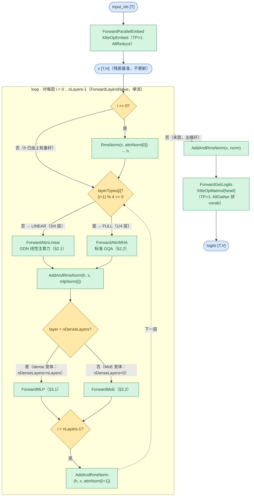
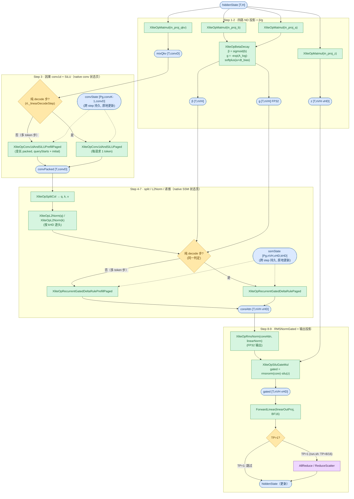
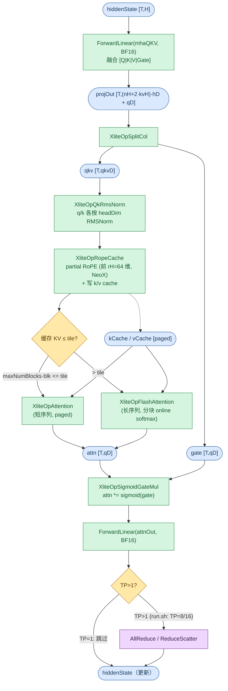
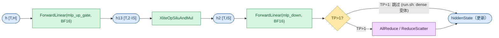
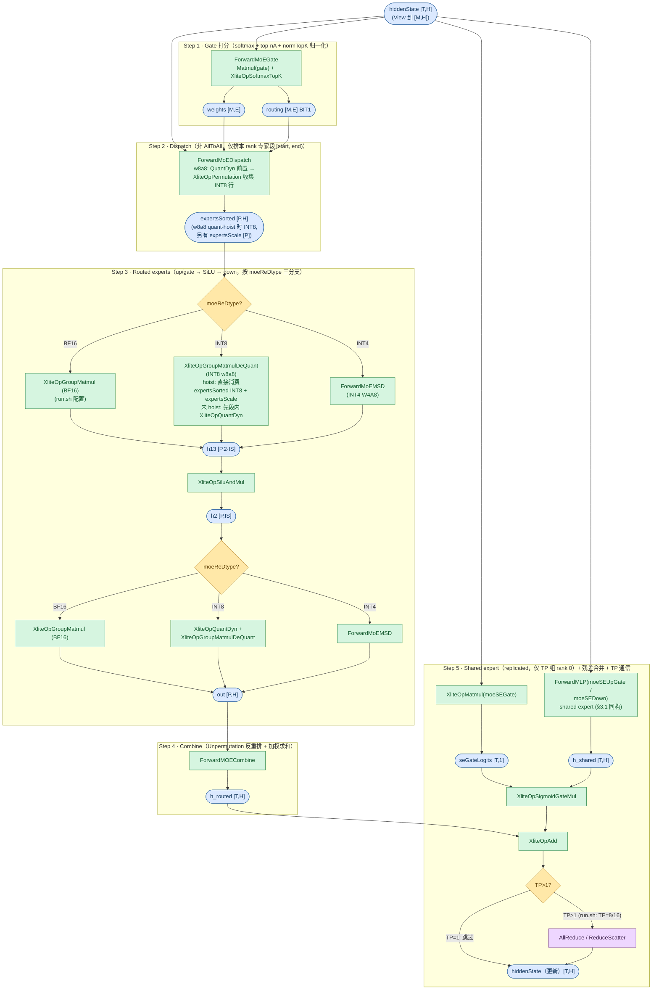

# Qwen3_5ForConditionalGeneration Forward 流程图

Qwen3.5 系列（`model_type=qwen3_5` / `qwen3_5_moe`）在 xlite C++ 侧的前向流程。两个变体共享 **Hybrid 注意力**架构（`attn_type=AttnHybridGdn`）：每 `full_attention_interval=4` 层中第 4 层为标准 GQA MHA（`ForwardAttnMHA`），其余 3/4 的层为 **Gated Delta Rule 线性注意力**（`ForwardAttnLinear`，GDN 结构，无 KV cache、递推状态）；FFN 部分区分 dense（全层稠密 MLP）与 MoE（全层 MoE + shared expert）。

**覆盖范围**：Qwen3.5-35B-A3B、Qwen3.5-122B-A10B（dense 变体 Qwen3.5-0.8B / 27B 见配置表）；**Qwen3.6-35B-A3B、Qwen3.8-27B 归入本系列**（同一 hybrid GDN 架构与 C++ 路径）。run.sh 无 Qwen3.6/3.8 的独立测试函数，下文数值举例均以 Qwen3.5 为准。

**与 Qwen3 系列的区别**（对照 [Qwen3ForCausalLM.md](Qwen3ForCausalLM.md)）：① 每 4 层 3 层为线性注意力层（递推状态，不写 paged KV）；② attention 输出门控 `attn_output_gate=True`，融合 QKV 权重 layout 为 `[Q|K|V|Gate]` 四段（Qwen3 为 `[Q|K|V]` 三段，无 SplitCol 步骤）；③ partial RoPE（`partial_rotary_factor=0.25` → `rope_head_dim=64`，Qwen3 全维）；④ RMSNorm 权重为 Gemma 式 `x*(1+w)`，加载时转换为标准 `x*w`。与 GLM-5.3-Flash / DeepSeek-V4 等 MHC 多流系列的区别：`hcMult==0`，主循环走单流 `ForwardLayersNaive`。

配置依据（取自 [tests/run.sh](../../../tests/run.sh) 中的真实模型测试函数）：

| 变体 | run.sh 函数 / 模型 | 部署 | FFN | 关键参数 |
|------|--------------------|------|-----|----------|
| `qwen3_5`（dense） | `run_qwen3_5_0.8B` / **Qwen3.5-0.8B** | TP=1（python 单卡） | 全 dense MLP（`n_dense_layers=n_layers=24`） | dim=1024, head_dim=256, n_heads=8, n_kv_heads=2(GQA), n_layers=24, inter_dim=3584, tie_word_embeddings=True, linear_{k,v}_heads=16/16 |
| `qwen3_5`（dense） | `run_qwen3_5_27B` / **Qwen3.5-27B** | TP=1 | 全 dense MLP（64 层） | dim=5120, n_heads=24, n_kv_heads=4, inter_dim=17408, linear_{k,v}_heads=16/48 |
| `qwen3_5_moe` | `run_qwen3_5_moe_35B` / **Qwen3.5-35B-A3B** | TP=8 + EP=8（`moe_ep_size=8, moe_tp_size=1`，torchrun 8 卡） | 全 MoE（`n_dense_layers=0`，`decoder_sparse_step=1`） | dim=2048, n_heads=16, n_kv_heads=2, n_layers=40, moe_inter_dim=512, shared_expert_inter_dim=512, n_routed_experts=256, n_activated_experts=8, n_shared_experts=1, norm_topk_prob=True, linear_{k,v}_heads=16/32（run.sh 未写 `linear_*`，取 [qwen3_5_moe.py](../../../tests/models/qwen3_5_moe.py) ModelArgs 默认） |
| `qwen3_5_moe` | `run_qwen3_5_moe_122B` / **Qwen3.5-122B-A10B** | TP=16 + EP=16（torchrun 16 卡） | 全 MoE（48 层） | dim=3072, n_heads=32, n_kv_heads=2, moe_inter_dim=1024, n_routed_experts=256, n_activated_experts=8, n_shared_experts=1, linear_{k,v}_heads=16/64 |

两变体共有（HF → `ModelConfig` 转换见 [qwen3_5.py](../../../tests/models/qwen3_5.py) / [qwen3_5_moe.py](../../../tests/models/qwen3_5_moe.py) 的 `init_xlite_model`）：`attn_type=AttnHybridGdn`、`full_attention_interval=4`、`attn_output_gate=True`、`qk_norm=True`（`qkNormFull=False`）、`partial_rotary_factor=0.25`（→ `rope_head_dim=64`）、`qkv_bias=False`、`linear_*`（Gated Delta Rule，§2.1）、`scoring_func=softmax` + `norm_topk_prob=True`（MoE 变体）、Gemma 式 RMSNorm 加载转换、权重 BF16 无量化（`ForwardLinear` / `XliteOpMatmul` 走 NO_QUANT）。

> 下文数值示例以 **Qwen3.5-35B-A3B**（TP=8+EP=8）与 **Qwen3.5-122B-A10B**（TP=16+EP=16）为准（per-rank 视角；`moeTPSize=1` 时 TP 组与 EP 组均为全 world）。run.sh 默认 `FORWARD_BACKEND=xlite`，qwen3.5 测试自带 xlite 后端接入；生产 vllm-ascend 适配器（`vllm_ascend/xlite/xlite.py` 的 `_supported_architectures`）当前未挂接 Qwen3.5 架构，`ModelConfig` 字段以该测试 harness 的转换为准。

源码入口：[`csrc/model.cpp`](../../../csrc/model.cpp) `XModel::Forward` / `ForwardAndGetLogits` → `ForwardEmbedAndLayers`（lm_head 见 §1 图末 `ForwardGetLogits`）。

## 图例与记号

图例（节点形状与配色、箭头语义）统一见 [图示规范](../../conventions/diagram_conventions.md) §4，本文各节 mermaid 图内的 classDef 与规范一致。

### Shape 记号（per-rank / TP 切分后）

下图所有 shape 记号均为单卡（per-rank）视角。`tp_size>1` 时带 `/tp` 的记号按 TP 切分，`kvH` 不足时复制（`n_kv_heads < tp` → `kvH=1`）；MoE 专家按 EP 切分（`E_loc`）；线性注意力头 `nKH`/`nVH` 也按 TP 切分（C++ 要求整除且 `nVH % nKH == 0`）。

| 记号 | 含义 | Qwen3.5-35B-A3B（MoE, TP=8+EP=8） | Qwen3.5-122B-A10B（MoE, TP=16+EP=16） |
|------|------|-----------------------------------|----------------------------------------|
| `T` | currTokens（当前步实际 token 数，运行时定，`T` ≤ `M`） | 运行时 | 运行时 |
| `M` | maxTokensDp：每步当前 token 数（DP>1 且 MoE 时为 DP pad 后行数），上界 = `max_num_batched_tokens` = `max_seq_len·max_batch_size` | ≤1024 | ≤1024 |
| `H` | hiddenSize（`dim`） | 2048 | 3072 |
| `nH` | nHeads / tp | 2 | 2 |
| `kvH` | max(nKvHeads / tp, 1)（GQA，不足复制） | 1 | 1 |
| `hD` | headDim | 256 | 256 |
| `rH` | ropeHeadDim（`partial_rotary_factor·hD` = 0.25·256） | 64 | 64 |
| `qD` | nH·hD（q / o / gate 投影维） | 512 | 512 |
| `qkvD` | (nH+2·kvH)·hD（融合 QKV 维） | 1024 | 1024 |
| `nKH` | linearNumKeyHeads / tp | 2 | 1 |
| `nVH` | linearNumValueHeads / tp | 4 | 4 |
| `kHD` | linearKeyHeadDim | 128 | 128 |
| `vHD` | linearValueHeadDim | 128 | 128 |
| `convK` | linearConvKernelDim | 4 | 4 |
| `convD` | nKH·kHD·2 + nVH·vHD（conv1d 通道数 = q+k+v 拼接维） | 1024 | 768 |
| `IS` | moeIntermediateSize / moeTPSize（MoE expert）；intermediateSize / tp（dense MLP） | 512 | 1024 |
| `sharedIS` | shared_expert_inter_dim（shared expert，replicated 不切分） | 512 | 1024 |
| `E` | nRoutedExperts | 256 | 256 |
| `E_loc` | E / moeEpSize（本 rank 物理专家段 `[start, end)` 长度） | 32 | 16 |
| `nA` | nActExperts | 8 | 8 |
| `P` | expertsSorted.shape[0] ≈ `M·nA`（dispatch 后 token×专家总数） | M·8 | M·8 |
| `Pg` | GDN 状态页数（convState / ssmState 第 0 维；页 0 为零页守卫，请求页由 cache manager 分配） | 2（=maxBatch+1） | 2（=maxBatch+1） |
| `blk` | blockSizes[0]（paged KV 块大小，仅 full-attention 层） | 128 | 128 |
| `B` | batch（rt._batch，运行时定） | 运行时 | 运行时 |
| `V` | vocabSize（head 输出维，TP 切分） | 248320 | 248320 |

> dense 变体（TP=1）：0.8B `H=1024, nH=8, kvH=2, qD=2048, nKH=nVH=16, convD=6144, IS=3584`；27B `H=5120, nH=24, kvH=4, qD=6144, nKH=16, nVH=48, convD=10240, IS=17408`。

### 复合维度计算示例

| 复合维度（图中的表达式） | 展开式 | Qwen3.5-35B-A3B（TP=8+EP=8） | Qwen3.5-122B-A10B（TP=16+EP=16） |
|--------------------------|--------|-------------------------------|-----------------------------------|
| MHA 融合投影 `projOut = (nH+2·kvH)·hD + qD`（§2.2） | qkv 维 + gate 维 | (2+2)·256+512 = **1536** | (2+2)·256+512 = **1536** |
| MHA `qkvD = (nH+2·kvH)·hD`（§2.2 `qkv`） | q+k+v 拼接 | (2+2)·256 = **1024** | (2+2)·256 = **1024** |
| MHA q/o/gate 维 `qD = nH·hD`（§2.2 `attn`/`gate`） | q 投影维 | 2·256 = **512** | 2·256 = **512** |
| Linear conv 通道 `convD = nKH·kHD·2 + nVH·vHD`（§2.1 `mixQkv`/`convPacked`） | q+k+v 拼接 | 2·128·2+4·128 = **1024** | 1·128·2+4·128 = **768** |
| Linear z/gated 维 `nVH·vHD`（§2.1 `z`/`core`） | value 拼接维 | 4·128 = **512** | 4·128 = **512** |
| Linear conv 状态页 `[Pg,convK-1,convD]`（§2.1 `convState`） | 卷积历史 | [2,3,**1024**] | [2,3,**768**] |
| Linear SSM 状态页 `[Pg,nVH,vHD,kHD]`（§2.1 `ssmState`） | 递推状态（K 连续） | [2,4,128,128] | [2,4,128,128] |
| Linear head 分组因子 `nVH/nKH`（§2.1 递推） | nVHeads/nKHeads | 4/2 = **2** | 4/1 = **4** |
| MoE gate `weights [M,E]`（§3.2） | token×专家打分 | [M,**256**] | [M,**256**] |
| MoE expert `h13 [P,2·IS]`（§3.2） | gate+up 拼接 | [M·8,**1024**] | [M·8,**2048**] |
| MoE expert `h2 [P,IS]` / `out [P,H]`（§3.2） | 中间激活 / expert 输出 | [M·8,**512**] / [M·8,**2048**] | [M·8,**1024**] / [M·8,**3072**] |
| shared expert `h13 [T,2·sharedIS]` / `h2 [T,sharedIS]`（§3.2） | shared expert 中间 | [T,**1024**] / [T,**512**] | [T,**2048**] / [T,**1024**] |
| paged KV cache / full 层 `[blkN, blk, kvH, hD]`（k 同 v） | blkN = `max_seq_len/blk · max_batch` | [8,128,1,256] | [8,128,1,256] |

> dense 变体（TP=1）§3.1：`h13 [T,2·IS]` / `h2 [T,IS]` 为 0.8B（IS=3584）[T,**7168**] / [T,**3584**]、27B（IS=17408）[T,**34816**] / [T,**17408**]。

---

## 1. 顶层主循环

`Forward` → `ForwardEmbedAndLayers` → `ForwardLayersNaive` 逐层循环（`hcMult==0` 恒成立，不画 MHC 分支，多流模型见 GLM-5.3-Flash / DeepSeek-V4 图；`enableCommOptimize` 时改走 `ForwardLayersCommOptimize`，run.sh 默认关闭）。Qwen3.5 无 DeepStack（`deepstackNumLevel=0`，不画该 Add 分支）；每层注意力先经 `ForwardAttn` 按 `_layerTypes[i]` 做层型分发（菱形 `layerTypes[i]?`）。



**关键点**：

- `x` 为全程残差基准（不更新），`h` 为工作张量 `[T,H]`，循环中原地改写。
- 层型交错：`(i+1) % fullAttentionInterval == 0` 的层走 `ForwardAttnMHA`，其余走 `ForwardAttnLinear`。`_layerTypes` 在 XModel 构造函数预计算；35B-A3B 为 10 full + 30 linear（共 40 层），122B-A10B 为 12 full + 36 linear（共 48 层）。
- `ForwardFFN`：`layer < nDenseLayers` → `ForwardMLP`；否则 `ForwardMoE`。dense 变体全层 MLP，MoE 变体全层 MoE。
- lm_head：`ForwardAndGetLogits` 在层循环后调 `ForwardGetLogits`（取各序列末 token 行 → `XliteOpMatmul(head)` → TP>1 `AllGather` 沿 vocab 拼回全量 logits）；0.8B `tie_word_embeddings=True` 时 head 绑定 embed 权重。

## 2. Attention

本系列两种层型按 `fullAttentionInterval=4` 交错：`(i+1) % 4 == 0` 的层（每 4 层的第 4 层）走 `ForwardAttnMHA`（§2.2），其余 3/4 的层走 `ForwardAttnLinear`（§2.1 GDN）；两者共用残差流 `AddAndRmsNorm`，内部路径各异。`ForwardAttn` 中 `IsHybridAttn(attnType)` 对本系列恒真，按构造时预计算的 `_layerTypes[layer]` 二选一分发（§1 图 `layerTypes[i]?` 菱形）；非 hybrid 分支（`MLA/DSA` → `ForwardAttnMLAV2`、纯 `MHA`）本系列不走，不画。

### 2.1 GDN 线性注意力（ForwardAttnLinear）

非 full-attention 层（3/4）走 **Gated Delta Rule 线性注意力**。该层不消费 RoPE（`freqsCis` 未用）、不写 paged KV；递推状态直接存放在调用者管理的 native 状态页（`convState` / `ssmState`，页号由 attnMeta 的 mamba 状态表给出，跨 step 持久）。四个输入投影权重为 ND 布局（NZ 权重不可 Concat），各自独立 `XliteOpMatmul`，零 D2D（host 侧融合入口 `linear_att_proj` 的 concat→matmul→split 三步组合仅用于测试，见 [linear_att_proj.md](../kernels/linear_att_proj.md)）。Step 3 与 Step 4-7 取同一运行时模式 `rt._linearDecodeStep`：纯 decode 步（每请求恰 1 个 query token 且已有缓存）走 paged 入口；多 token 步——含新鲜 prefill、chunked prefill 续算与投机解码验证——一律走 packed prefill 入口。



**关键点**：

- **四路独立 ND 投影**：`in_proj_qkv`（→ `mixQkv`，含 q/k/v 三段）、`in_proj_z`（→门控）、`in_proj_b`（→β 输入）、`in_proj_a`（→g 输入）；per-rank 权重行数分别为 `convD` / `nVH·vHD` / `nVH` / `nVH`。
- **β/g**：`XliteOpBetaDecay` 一次产出两者（log-space 衰减，kernel 内取 `exp(g)`；g 走 FP32 native gate 变体，见 [beta_decay.md](../kernels/beta_decay.md)）。
- **conv1d+SiLU 融合**（`convK=4`，depthwise，`groups=convD`）：对 `mixQkv` 做因果卷积 + SiLU 并原位更新 `convState` 页；prefill 先把卷积结果舍入 activation dtype 再 SiLU，decode 保留融合 FP32 SiLU 后舍入（见 [conv1d_and_silu_paged.md](../kernels/conv1d_and_silu_paged.md)）。
- **native 状态页**：页号来自 attnMeta family slot `blockTables[1..]`（mamba 状态表），`queryStartLoc[B+1]` 描述 token 分段，`cachedLens[B]` 兼作 initial 标志（0 = 从零状态起算，>0 = 保留页内状态续算，chunked prefill 跨步复用）；页 0 / 负页号输出零且不更新（守卫）。测试 harness 中 `Pg = max_batch+1`（页 0 保留，请求 i 占页 i+1）。
- **L2Norm + 分组头**：q/k 各按 `kHD=128` 逐头 L2 归一化；`nVH > nKH` 的分组头由递推 kernel 直接寻址（value head h 读 key head `h // (nVH/nKH)`），无需 repeat_interleave 扩展 q/k。35B-A3B 分组 2（nKH=2, nVH=4），122B-A10B 分组 4（nKH=1, nVH=4）。
- **递推（无 chunk）**：逐 token 串行递推（非 FLA chunk WY 矩阵乘算法），并行按（序列 × 头 × V tile）。每个 token（[recurrent_gated_delta_rule_paged.md](../kernels/recurrent_gated_delta_rule_paged.md)，S ∈ R^{vHD×kHD}）：

```
S ← S · exp(g_t)              状态衰减
δ_t = β_t · (v_t − S·k_t)     预测误差
S ← S + δ_t · k_tᵀ            状态更新
o_t = S · q_t / √kHD          读出（1/√kHD 在 kernel 内施加）
```

- **RMSNormGated**：`XliteOpRmsNorm`（FP32 输出）+ `XliteOpSiluGateMul` 得 `rmsnorm(core)·silu(z)`（与 Python 侧 `RMSNormGated` 一致；linear 层 norm 权重为标准 `x·w`，不做 Gemma 转换）。
- **TP>1 末尾通信**：`out_proj` 为 RowParallel，输入按 `nVH·vHD` 切分；同 §2.2。

### 2.2 标准 MHA（ForwardAttnMHA）

标准 GQA 注意力，权重 BF16 走 NO_QUANT。`attn_output_gate=True` 时融合 QKV 权重 layout 为 `[Q|K|V|Gate]`，单次 `XliteOpSplitCol` 即得连续 `[Q|K|V]` 与 `gate`（Qwen3 三段无此步骤，见 [Qwen3ForCausalLM.md](Qwen3ForCausalLM.md) §2）。



**关键点**：

- **QKV 投影无 bias**（`qkv_bias=False`），权重 BF16 走 NO_QUANT。HF checkpoint 的 `q_proj` 每头交错输出 `[q|gate]`，加载时重排为 `[Q|K|V|Gate]` 四段（[qwen3_5.py](../../../tests/models/qwen3_5.py) 的 `_mha_qkv_weight`），故 gate 段与 q 同宽 `qD`。
- **QK-norm**（`qk_norm=True`，`qkNormFull=False`）：q、k 各自按 `headDim=256` 做 RMSNorm；Gemma 式权重已在加载时转为标准 `x*w`。
- **Partial RoPE**：`rope_head_dim=64`，仅前 64 维旋转，NeoX 风格非交错；`XliteOpRopeCache` 同时完成 q/k 的 RoPE 与 paged KV cache 写入。
- **GQA 复制**：`kvH = max(nKvHeads/tp, 1)`。两个 MoE 举例模型 `n_kv_heads=2 < tp`（8/16）→ `kvH=1`。
- **Attention 路径**：分支条件 `maxNumBlocks·blk <= rt._tileSizeOfCachedKV`（tile 阈值运行时定）。`maxNumBlocks` = block table 列数 = `max_seq_len/blk` = 8，`8·128 = 1024 ≤ 8192` → run.sh 配置（`max_seq_len=1024`）下恒走 `XliteOpAttention` 短路径；缓存更长时走 `XliteOpFlashAttention`。
- **输出门控**（`attn_output_gate=True`）：`XliteOpSigmoidGateMul` 把 attention 输出乘 `sigmoid(gate)`（语义见 [sigmoid_gate_mul.md](../kernels/sigmoid_gate_mul.md)）。
- **TP>1 末尾通信**：`enableCommOptimize` 时 `ReduceScatter`，否则 `AllReduce`；TP=1（dense 变体）跳过。

## 3. FFN

FFN 无层内交错，两种层型为**系列内模型变体差异**（同一模型全层同型）：`XModel::ForwardFFN` 按 `layer < nDenseLayers` 二选一分发——dense 变体（`model_type=qwen3_5`）`nDenseLayers=nLayers`，全层 `ForwardMLP`（§3.1）；MoE 变体（`model_type=qwen3_5_moe`）`nDenseLayers=0`（`decoder_sparse_step=1`、`mlp_only_layers=[]`），全层 `ForwardMoE`（§3.2）。

### 3.1 稠密 MLP（ForwardMLP，dense 变体）



SwiGLU（`gate·silu(up)`），权重 BF16 无量化（`swiglu_limit` 未配置，默认 0 不启用 clamp）。dense 变体全层走此路：0.8B `IS=3584`、27B `IS=17408`（均 TP=1）。`ForwardMLP` 同构复用于 §3.2 的 shared expert（`moeSEUpGate` / `moeSEDown`，`withAllReduce=false`，通信由 MoE 末尾统一执行）。SiLU 融合语义见 [silu_and_mul.md](../kernels/silu_and_mul.md)。

### 3.2 MoE（ForwardMoE，qwen3_5_moe 变体）

`scoring_func=softmax` + `norm_topk_prob=True`、**有 shared expert**（`n_shared_experts=1`，权重 replicated 不切分）、无 EPLB 冗余专家（gate 后的 log→physical 重映射 `XliteOpRemapGateOutputs` 零开销跳过）。以 **Qwen3.5-35B-A3B**（TP=8+EP=8）与 **Qwen3.5-122B-A10B**（TP=16+EP=16）为例：`IS=512/1024`（`moe_tp_size=1`，expert 权重不按 TP 切分）、`E=256`、`E_loc=32/16`、`nA=8`。



**关键点**：

- **Gate**（BF16 权重）：`XliteOpSoftmaxTopK` 一次完成 softmax 打分、top-`nA` 与 `normTopK` 归一化，输出归一化系数 `weights [M,E]` 与 BIT1 掩码 `routing [M,E]`。**无 gate bias**（softmax 路径不消费 `e_score_correction_bias`，与 GLM5.2 的 sigmoid 路径不同）。
- **Dispatch（非 AllToAll）**：`enableMoEAllToAll=false`（run.sh / 默认）走 `XliteOpPermutation`，把 token 按 routing 重排为 expert 分组的 `expertsSorted [P,H]`（`mAllDp` 超过阈值 1024 时按 `activeTokensRatioPerEp` 压缩预分配行数）。EP>1 时仅排本 rank 物理专家段 `[start, end)`（`start = rankId/moeTPSize · E_loc`；`moeTPSize=1` 时即 `rankId·E_loc`，每 rank `E_loc=32/16` 个专家）。DP>1 时 dispatch 前另有 AllGather 打包分发（`XliteOpConcat` → `AllGather` → `XliteOpSplit`，图中省略；run.sh DP=1）。**w8a8 quant-hoist**（`moeReDtype==INT8` 且 `hiddenSize%32==0`，非 AllToAll / graph 通信，默认启用）：`XliteOpQuantDyn` 前置到 permutation 之前（per-token 量化 hiddenState），permutation 收集 INT8 行并把 per-token scale 搭带散射到对应专家槽，`expertsSorted` 为 INT8、另有 `expertsScale [P]` FP32（`expertsSorted` 缓冲减半、量化 M 行而非 P 行、DP>1 AllGather 载荷减半）；`XLITE_DISABLE_MOE_QUANT_HOIST` 可回退 legacy BF16 收集。
- **Expert 计算**：按 `moeReDtype` 三分支——BF16（run.sh 测试，expert 权重加载时转置为 `[in,out]`，`experts_weight_transpose=True`）直接 `XliteOpGroupMatmul`（按 expert 分组的 batched matmul，语义见 [group_matmul.md](../kernels/group_matmul.md)）；INT8（生产 w8a8）up/gate 段 quant-hoist 生效时直接 `XliteOpGroupMatmulDeQuant`（`expertsScale` 参与解量化），未 hoist（AllToAll / graph 通信 / 显式禁用）才段内 `XliteOpQuantDyn`；INT4（W4A8）走 `ForwardMoEMSD`。up/gate 与 down 两段各自独立走该分支（down 段 `h2` 恒段内 `QuantDyn`）。
- **Combine**：`ForwardMOECombine`（Unpermutation 反重排 + 按 `weights` 加权求和）把 `[P,H]` 还原回 `[M,H]`。各 rank 只产出本 rank 专家段的 routed 部分，完整 routed 结果与 shared expert 分量均由末尾 TP 通信求和（TP 组 = 全 world）。
- **Shared expert**（`n_shared_experts=1`，replicated）：TP 组 rank 0 上先 `seGateLogits = XliteOpMatmul(moeSEGate [1,H])`，`ForwardMLP`（§3.1 同构，`sharedIS` 中间维）算 `shared(x)`，`hiddenState = h_routed + sigmoid(seGate(x))·shared(x)`（`XliteOpSigmoidGateMul` + `XliteOpAdd`）。仅 rank 0 计算的原因：shared 权重为全量（`_isSharedExpertWeightFull`），rank 0 加一份、其余 rank 加零份，经末尾 TP AllReduce/ReduceScatter 后各 rank 恰好得到一份。
- **TP>1 末尾通信**：非 AllToAll 时 `AllReduce`（`enableCommOptimize` 时 `ReduceScatter`）。run.sh TP=8/16，此步执行。
